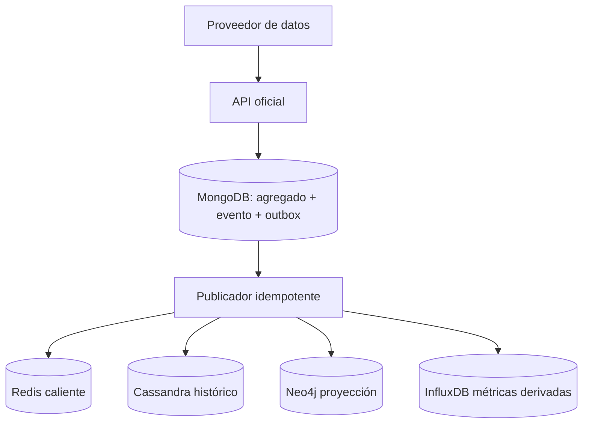
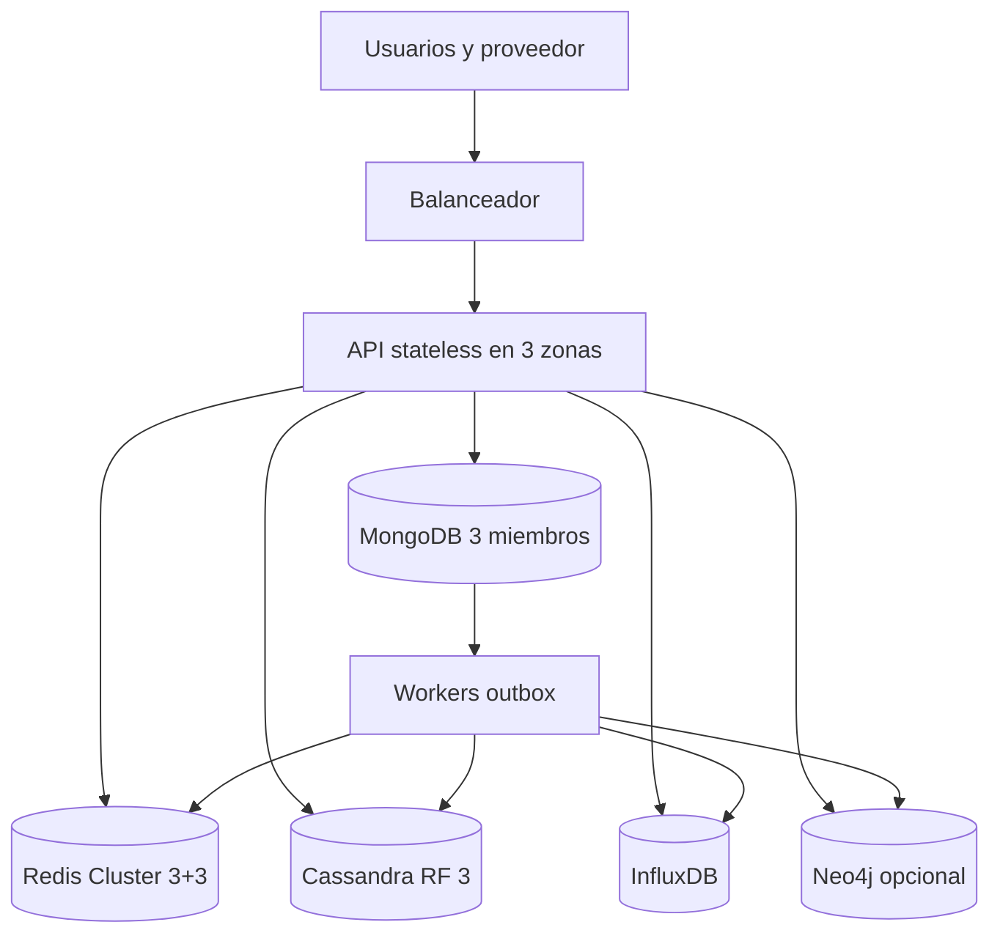

# Fixture 2030 — Arquitectura distribuida, CAP, consistencia, particionado y replicación

**Estado:** propuesta detallada para validación  
**Versión:** 1.0  
**Fecha:** 1 de noviembre de 2026  
**Documentos relacionados:** `alcance_funcional_fixture2030.md`, `02_patrones_acceso_y_requisitos_fixture2030.md` y `03_comparacion_motores_y_estrategia_cap.md`

---

## 1. Objetivo

Este documento desarrolla la arquitectura distribuida objetivo de Fixture 2030. Responde punto por punto a los componentes solicitados en el Hito 3:

1. Análisis CAP.
2. Modelos de consistencia.
3. Estrategia de distribución.
4. Plan de escalabilidad.
5. Topología y resiliencia.

El análisis parte de las decisiones ya aprobadas:

- MongoDB es la fuente oficial de equipos, jugadores, usuarios, fixture, partidos, alineaciones, sustituciones y eventos oficiales.
- Redis conserva sesiones y copias calientes reconstruibles.
- Cassandra es la fuente durable de comentarios y auditoría reciente, y puede mantener proyecciones históricas.
- InfluxDB conserva estadísticas temporales y mapas de calor.
- Neo4j es una proyección opcional para consultas de varios saltos.
- El almacenamiento de objetos conserva multimedia y archivos históricos.
- InterSystems IRIS queda excluido de la arquitectura.

La arquitectura local desarrollada en Docker demuestra funcionalidades, modelos y conexiones. No demuestra por sí sola alta disponibilidad, distribución geográfica ni capacidad productiva. En este documento se distingue siempre entre:

- **Implementación académica actual:** instancias locales, generalmente de un nodo.
- **Arquitectura objetivo:** clústeres, réplicas, zonas, failover y escalabilidad horizontal.

---

## 2. Principios de diseño

### 2.1 CAP se decide durante una partición

CAP no significa elegir dos letras para toda la plataforma en todo momento. Cuando la red funciona correctamente pueden coexistir consistencia y disponibilidad. El conflicto aparece cuando dos grupos de nodos dejan de comunicarse.

Como Fixture 2030 es distribuido, la tolerancia a particiones es obligatoria. Por cada operación se debe decidir entre:

- **CP:** conservar consistencia y rechazar o demorar operaciones en el lado que no puede alcanzar el quórum.
- **AP:** continuar respondiendo aunque alguna copia pueda estar temporalmente desactualizada.

### 2.2 No todos los datos tienen el mismo valor

No es equivalente perder o atrasar:

- Un gol oficial.
- Un cambio de rol.
- Un comentario.
- Un contador de likes.
- Una posición del mapa de calor.
- Una caché de equipo.

La garantía se define según el impacto funcional, no solamente según el motor disponible.

### 2.3 No se confirma lo que todavía puede perderse

Una respuesta exitosa significa algo diferente según la operación:

- Un evento oficial se confirma después de quedar replicado en la mayoría de MongoDB.
- Un comentario se confirma después del quórum de escritura definido en Cassandra.
- Una estadística se acepta cuando queda persistida o incorporada a un mecanismo durable de reintento.
- Una actualización de caché no determina el éxito de la operación oficial.

Redis nunca será la única copia de un gol, comentario, usuario o partido.

### 2.4 Las proyecciones son reconstruibles

Redis, Neo4j y las proyecciones históricas derivadas no participan en la transacción oficial. Se actualizan mediante `outbox`, identificadores idempotentes y reintentos.

La indisponibilidad de una proyección no debe impedir que la fuente oficial acepte una operación válida.

### 2.5 El tráfico social se aísla del tráfico oficial

Una final puede multiplicar comentarios y lecturas sin aumentar proporcionalmente la cantidad de goles o sustituciones. Por lo tanto:

- Los endpoints oficiales y sociales tendrán pools de conexión separados.
- Los workers de comentarios no competirán con los workers de eventos.
- Se podrán aplicar límites a comentarios sin afectar el marcador.
- Redis y Cassandra podrán escalar independientemente de MongoDB.

---

## 3. Contextos de carga

No se inventará una cantidad productiva de usuarios sin validación de la cátedra. La capacidad se expresará mediante variables y niveles relativos.

### 3.1 Escenarios obligatorios

| Escenario | Características | Riesgo dominante |
|---|---|---|
| Partido habitual | Tráfico estable, comentarios moderados y consultas distribuidas entre varios partidos. | Funcionamiento general y costos. |
| Jornada con varios partidos | Varias claves de partido activas simultáneamente. | Conexiones, pools y distribución entre particiones. |
| Semifinal | Audiencia concentrada y ráfagas después de eventos. | Hotspots y crecimiento de latencia. |
| Final | Máxima concentración en un solo partido, timeline y marcador. | Partición caliente, saturación y efecto cascada. |
| Final con gol o penales | Ráfaga breve muy superior al promedio. | Backpressure, deduplicación y colas. |
| Final con caída de nodo | Pico de tráfico con capacidad reducida. | Resiliencia real, no solo throughput normal. |
| Partición de red | Dos grupos de nodos no pueden comunicarse. | Elección explícita entre consistencia y disponibilidad. |

### 3.2 Niveles de prueba

La prueba académica deberá ejecutar como mínimo:

- `1x`: carga de referencia.
- `5x`: escenario equivalente a semifinal.
- `10x`: escenario sostenido de final.
- Ráfaga sobre `10x`: incremento breve para simular gol, penal o finalización.
- Repetición de `10x` con un nodo fuera de servicio.

Los multiplicadores son niveles de prueba, no afirmaciones sobre tráfico real.

### 3.3 Fórmulas de capacidad

Comentarios:

```text
comentarios_pico = comentarios_por_segundo × segundos_del_pico

escrituras_por_particion = comentarios_por_segundo / cantidad_de_shards

almacenamiento_replicado = comentarios_totales × bytes_promedio × factor_de_replica
```

Lecturas públicas:

```text
lecturas_backend = solicitudes_publicas × (1 - cache_hit_ratio)
```

Estadísticas de equipo:

```text
puntos = partidos_activos × equipos_por_partido × duración_segundos / intervalo_segundos
```

Posiciones de jugadores:

```text
puntos_posicionales = partidos_activos × jugadores_en_cancha × duración_segundos / intervalo_posicional
```

El intervalo posicional definitivo todavía debe validarse. No se asumirá que coincide obligatoriamente con los 10 segundos de las estadísticas de equipo.

---

## 4. Análisis CAP por subsistema

### 4.1 Resumen

| Subsistema | Prioridad durante partición | Garantía principal | Decisión funcional |
|---|---|---|---|
| Partido, marcador y evento oficial | CP | Consistencia fuerte | Solo el lado con mayoría puede modificar el estado oficial. |
| Alineaciones y sustituciones | CP | Consistencia fuerte y orden por partido | No se confirma una sustitución contradictoria. |
| Usuarios y roles | CP para escrituras | Consistencia fuerte | Un cambio de privilegios no puede divergir. |
| Catálogo público | AP para lecturas | Eventual en caché | Puede mostrarse una ficha temporalmente desactualizada. |
| Sesiones | CP para acciones protegidas | Consistencia de sesión | Ante duda de autenticación se rechaza la acción. |
| Comentarios | Quórum para escritura; AP para lectura | Eventual y de sesión | Se priorizan lecturas; una publicación exige durabilidad mínima. |
| Likes y contadores | AP | Eventual | Pueden converger o recalcularse. |
| Estadísticas y mapas | AP | Eventual, orden por timestamp | Se muestra el último dato disponible y se completa después. |
| Rankings | AP | Eventual y monotónica | Se muestra la última versión y se recalcula. |
| Auditoría | CP en el registro de origen | Durable y causal | La operación deja evidencia durable antes de propagarse. |
| Neo4j y otras proyecciones | AP | Eventual | Pueden atrasarse o deshabilitarse sin perder el dato oficial. |
| Multimedia | AP para consulta | Eventual | Una imagen ausente no bloquea el partido. |

### 4.2 Partido, marcador y eventos oficiales

**Elección:** CP.

Un gol no puede existir en una mitad de la red y no existir en la otra. Tampoco se puede finalizar un partido mientras otro nodo todavía acepta eventos normales.

Durante una partición:

- El grupo MongoDB que conserva la mayoría puede seguir aceptando comandos oficiales.
- El grupo minoritario rechaza escrituras.
- Redis puede continuar mostrando el último estado confirmado, junto con `actualizado_en` y `version`.
- La API nunca inventa disponibilidad aceptando un evento en un nodo aislado.

**Trade-off aceptado:** puede existir una pausa breve de escritura durante la elección de un nuevo primario o la pérdida de mayoría. Se sacrifica disponibilidad antes que aceptar dos marcadores oficiales.

### 4.3 Alineaciones y sustituciones

**Elección:** CP y consistencia causal.

Una sustitución depende de hechos anteriores:

1. El partido comenzó.
2. El jugador saliente estaba en cancha.
3. El jugador entrante estaba habilitado como suplente.
4. El intervalo del saliente se cierra.
5. El intervalo del entrante se abre.

Todas estas modificaciones se realizan en una transacción MongoDB y con una versión del agregado Partido.

**Conflicto:** si dos comandos intentan sustituir al mismo jugador, solamente uno actualiza la versión esperada. El otro se rechaza y debe releer el estado.

### 4.4 Usuarios y roles

**Elección:** CP para altas, bajas, bloqueo y modificación de roles.

Una réplica atrasada puede utilizarse para mostrar preferencias no críticas, pero no para decidir si el usuario es administrador.

**Trade-off aceptado:** si no puede verificarse el rol más reciente, la operación administrativa se rechaza.

### 4.5 Catálogo de equipos y jugadores

**Elección:** AP para lectura; CP para cambios maestros.

Una ficha o ranking descriptivo puede servirse desde caché aun si tiene algunos segundos de atraso. En cambio, una actualización administrativa se confirma en MongoDB por mayoría.

La respuesta cacheada incluirá su fecha de actualización para evitar presentar datos indefinidamente viejos.

### 4.6 Sesiones

Las sesiones tienen una decisión mixta:

- Para navegar información pública se prioriza disponibilidad.
- Para publicar, moderar o administrar se valida la sesión de manera segura.
- Si Redis no puede confirmar la sesión, la API falla de forma cerrada para acciones protegidas.
- La pérdida de una sesión no implica pérdida de perfil; obliga a volver a autenticarse.

**Trade-off aceptado:** se admite reautenticación para no aceptar acciones con identidad dudosa.

### 4.7 Comentarios

Los comentarios requieren separar lectura y escritura.

**Publicación:** se exige quórum local en Cassandra antes de responder `201 Created`.  
**Lectura del feed:** puede utilizar una réplica y aceptar información temporalmente atrasada.  
**Lectura del autor:** la respuesta de creación y una copia temporal en Redis ofrecen consistencia de sesión.  
**Moderación:** utiliza lectura más fuerte para no actuar sobre una copia vieja.

Durante una partición `2 + 1` de un clúster de tres réplicas:

- El lado de dos réplicas sigue aceptando comentarios.
- El nodo aislado puede servir un feed desactualizado si la aplicación lo permite.
- El nodo aislado no confirma nuevas publicaciones porque no alcanza quórum.

**Trade-off aceptado:** se pierde disponibilidad de escritura en la minoría para no confirmar comentarios que solo existan en una réplica aislada.

### 4.8 Likes y contadores

**Elección:** AP y consistencia eventual.

Los contadores pueden mantenerse temporalmente en Redis, acumularse y consolidarse. Un número de likes atrasado no invalida el partido ni el comentario.

Se utilizarán operaciones atómicas, identificadores de usuario y deduplicación para evitar contar dos veces el mismo reintento.

### 4.9 Estadísticas, posiciones y mapas de calor

**Elección:** AP y consistencia eventual.

Una medición atrasada puede incorporarse posteriormente conservando su timestamp original. La API mostrará:

- Último timestamp disponible.
- Granularidad.
- Estado `actual`, `atrasado` o `parcial`.

Si InfluxDB no está disponible, el proveedor o el componente de ingesta debe retener temporalmente los lotes y reintentarlos. No se transformará Redis en fuente histórica de emergencia.

**Trade-off aceptado:** el mapa puede estar incompleto durante algunos segundos, pero se recompone cuando llegan los datos pendientes.

### 4.10 Rankings

**Elección:** AP, eventual y monotónica.

Redis puede mostrar un ranking vivo derivado. Para no retroceder visualmente a una versión anterior, cada ranking llevará:

- `version`.
- `calculado_en`.
- Ventana o fase considerada.

Si se pierde Redis, el ranking se recalcula desde eventos de MongoDB y estadísticas de InfluxDB.

### 4.11 Auditoría

El registro de auditoría debe originarse de forma durable, pero su proyección puede ser eventual.

- La transacción oficial escribe un registro `outbox` con `request_id`, actor, acción y resultado.
- Un worker lo proyecta en Cassandra.
- Si Cassandra está caída, el `outbox` conserva la tarea pendiente.
- El worker reintenta de forma idempotente.

No se utilizará una transacción distribuida entre MongoDB y Cassandra.

### 4.12 Neo4j y demás proyecciones

Neo4j no decide el resultado ni la alineación. Si queda aislado:

- Se suspenden las consultas de grafo complejas.
- Las operaciones oficiales continúan.
- El desfase se mide mediante un checkpoint de secuencia.
- La proyección se reconstruye o completa cuando vuelve la conexión.

---

## 5. Modelos de consistencia

### 5.1 Consistencia fuerte

Se aplica a:

- Estado oficial del partido.
- Marcador.
- Eventos oficiales.
- Alineaciones y sustituciones.
- Correcciones de eventos.
- Roles y bloqueos de usuarios.
- Confirmación de una operación administrativa.

La lectura utilizada para tomar una decisión debe provenir del primario o de una mayoría vigente. Las cachés no autorizan cambios.

### 5.2 Consistencia causal

Se aplica cuando una operación depende de otra:

- Sustitución después de la alineación.
- Evento después del inicio del partido.
- Corrección después del evento original.
- Ranking después de un gol o asistencia.
- Mapa de calor después del ingreso del suplente.

Cada partido tendrá una secuencia creciente:

```text
partido_id + secuencia_evento
```

Las proyecciones no aplican la secuencia `n + 1` si todavía falta `n`. Pueden retenerla, reintentar o solicitar reconciliación.

### 5.3 Consistencia de sesión

Se utiliza para que un usuario:

- Vea su comentario inmediatamente después de publicarlo.
- No vuelva a una versión anterior del feed.
- Observe sus propias preferencias actualizadas.

Se logra con:

- Respuesta que contiene el recurso creado.
- Cursor o versión monotónica.
- Caché temporal asociada al usuario.
- Lectura posterior con token de consistencia cuando corresponda.

### 5.4 Consistencia eventual

Se acepta para:

- Comentarios visibles para otros usuarios.
- Likes.
- Rankings en vivo.
- Estadísticas recientes.
- Mapas de calor.
- Neo4j.
- Cachés de catálogo.
- Archivo histórico.

La consistencia eventual no significa ausencia de control. Cada proyección tendrá:

- Identificador idempotente.
- Secuencia o timestamp de origen.
- Estado de procesamiento.
- Métrica de retraso.
- Reconciliación periódica.

### 5.5 Resolución de conflictos

| Conflicto | Resolución |
|---|---|
| Reintento del mismo evento | `evento_id` o `idempotency_key` único; se devuelve el resultado previo. |
| Dos cambios concurrentes del partido | Control optimista con campo `version`; uno confirma y el otro relee. |
| Evento fuera de orden | Se retiene o rechaza según `secuencia_evento`; no se ordena solo por hora del cliente. |
| Corrección de gol | Evento compensatorio o nueva versión; no se borra silenciosamente el original. |
| Comentario duplicado | Identificador único del cliente/proveedor y deduplicación temporal. |
| Likes concurrentes | Operación atómica y unicidad `comentario_id + usuario_id`. |
| Proyección atrasada | Reprocesamiento desde checkpoint y `outbox`. |
| Timestamp estadístico repetido | Clave idempotente definida por partido, entidad, métrica y timestamp. |

---

## 6. Estrategia de distribución por motor

## 6.1 MongoDB

### Responsabilidad

- Equipos.
- Jugadores.
- Usuarios.
- Fixture.
- Partidos.
- Alineaciones.
- Sustituciones.
- Eventos oficiales.
- `outbox`.

### Replicación objetivo

Replica set de tres miembros distribuidos entre tres zonas:

```text
Nodos             = 3
Primary           = 1
Secondaries       = 2
writeConcern      = majority
readConcern       = majority para decisiones oficiales
readPreference    = primary para reglas oficiales
```

La réplica de tres nodos tolera la pérdida de un nodo sin perder mayoría.

### Particionado

Para el torneo académico, equipos, jugadores y 96 partidos son volúmenes acotados. No se justificará sharding solo por demostrarlo: un replica set es suficiente.

Si se extiende la plataforma a múltiples competencias:

- `usuarios`: distribución hash por `usuario_id`.
- `eventos_oficiales`: distribución por `partido_id`.
- `partidos`: misma clave lógica de partido que sus eventos para favorecer afinidad.
- `outbox`: partición por `partido_id` y orden por secuencia.

Los eventos se guardan en una colección separada. No se agregan indefinidamente dentro del documento Partido.

### Hotspot de la final

Todos los eventos oficiales de la final pertenecen al mismo partido, pero su frecuencia es baja comparada con comentarios o lecturas. Se acepta que las escrituras oficiales de un partido queden ordenadas en un mismo agregado.

Las lecturas masivas no golpean directamente a esa partición porque se sirven desde Redis.

### Fallos

- Caída del primario: elección de un nuevo primario; se pausa brevemente la escritura.
- Caída de un secundario: el sistema continúa con mayoría.
- Pérdida de dos miembros: se rechazan escrituras oficiales.
- Partición `2 + 1`: el lado de dos nodos continúa; el aislado no acepta escrituras.

### Riesgo reconocido

Una transacción que abarque varios shards aumenta latencia y complejidad. Por eso se busca afinidad por partido y se evita fragmentar prematuramente el agregado oficial.

---

## 6.2 Redis

### Responsabilidad

- Sesiones con TTL.
- Estado caliente del partido.
- Marcador visible.
- Timeline reciente.
- Últimas estadísticas.
- Rankings en vivo.
- Rate limiting.
- Contadores y deduplicación temporal.

### Topología objetivo

Para alta carga se propone Redis Cluster con:

- Tres nodos primarios.
- Una réplica por primario.
- Distribución entre tres zonas.
- AOF habilitado para sesiones y datos temporalmente autoritativos.

La implementación académica actual con una instancia y AOF demuestra persistencia local, no failover distribuido.

### Particionado de claves

Sesiones:

```text
sesion:{sesion_id}
```

El hash del identificador distribuye sesiones entre slots.

Estado oficial cacheado:

```text
partido:{partido_id}:estado
partido:{partido_id}:marcador
```

Los datos que deben modificarse atómicamente pueden compartir hash tag. No se colocará todo el tráfico de comentarios de la final en el mismo hash tag.

Comentarios recientes:

```text
comentarios:{partido_id}:{bucket}:{shard}
```

### Final y semifinal

- El estado y marcador ocupan claves pequeñas, aunque sean muy leídas.
- Se permiten réplicas de lectura para endpoints públicos que toleren un atraso breve.
- Los comentarios recientes se segmentan para evitar una única estructura gigante.
- El rate limit se evalúa antes de consultar Cassandra.
- La caché debe utilizar expiraciones con dispersión para evitar que muchas claves expiren al mismo instante.

### Fallos

- Pérdida de caché: se reconstruye desde las fuentes durables.
- Pérdida de sesión: el usuario vuelve a autenticarse.
- Failover de réplica asíncrona: puede perderse una ventana mínima de datos temporales; nunca un gol oficial.
- Saturación de memoria: se protegen sesiones y claves críticas con namespaces, límites y políticas separadas.

### Trade-off

Redis mejora latencia y absorbe lecturas, pero agrega invalidación y reconstrucción. No se lo presenta como sustituto de MongoDB, Cassandra o InfluxDB.

---

## 6.3 Cassandra

### Responsabilidad

- Comentarios por partido.
- Comentarios por usuario.
- Auditoría reciente.
- Timeline histórico derivado de eventos, si las pruebas justifican esa proyección.

### Replicación objetivo

Configuración inicial dentro de una región:

```text
N = 3 réplicas
```

Los nodos se distribuyen en tres zonas y se utiliza una estrategia consciente de topología. La implementación local de un nodo y factor uno queda documentada como laboratorio, no como arquitectura objetivo.

### Niveles de consistencia

| Operación | W/R propuesto | Justificación |
|---|---|---|
| Publicar comentario | `W = LOCAL_QUORUM` | Dos de tres réplicas confirman antes de responder. |
| Leer feed público | `R = LOCAL_ONE` | Baja latencia; se acepta atraso temporal. |
| Leer para moderar | `R = LOCAL_QUORUM` | Se reduce el riesgo de actuar sobre una copia antigua. |
| Escribir auditoría | `W = LOCAL_QUORUM` | La evidencia requiere mayor durabilidad. |
| Consultar auditoría crítica | `R = LOCAL_QUORUM` | Lectura más fuerte para investigación. |
| Proyección histórica reconstruible | `W = LOCAL_ONE` o asíncrona | Puede reprocesarse desde la fuente oficial. |

Con `N=3`, `W=2` y lectura pública `R=1`, se cumple `R + W = N`, no `R + W > N`; no se promete consistencia fuerte para el feed.

Con `N=3`, `W=2` y lectura administrativa `R=2`, se cumple `R + W > N`; se obtiene una lectura más fuerte al costo de latencia y disponibilidad.

### Partición de comentarios por partido

La clave académica anterior:

```text
(partido_id, bucket_10min)
```

puede producir una partición caliente en una final.

La arquitectura objetivo utiliza:

```text
partition key = (partido_id, bucket_1min, shard)
clustering    = (creado_en DESC, comentario_id)
```

El shard se calcula de manera determinística:

```text
shard = hash(usuario_id) mod shard_count
```

### Cantidad de shards

No se fija arbitrariamente. Se calcula y prueba:

```text
shard_count = ceil(comentarios_por_segundo_pico / objetivo_escrituras_por_particion)
```

Se evaluarán 4, 8 y 16 shards. Cada partido tendrá configurado su `shard_count` antes del inicio según su categoría de carga.

**Costo aceptado:** para obtener el timeline global, la API consulta todos los shards activos de la ventana, recupera una cantidad limitada por shard y fusiona por timestamp.

### Proyección por usuario

```text
partition key = (usuario_id, bucket_dia)
clustering    = (creado_en DESC, comentario_id)
```

Se acepta duplicación porque responde a un patrón distinto. No se ejecuta un escaneo global de comentarios.

### Auditoría

```text
partition key = (servicio, fecha_dia, shard)
clustering    = (timestamp DESC, auditoria_id)
```

Para investigar un recurso específico puede mantenerse una segunda tabla derivada por `tipo_recurso + recurso_id + período`.

### Riesgos y mitigaciones

| Riesgo | Mitigación |
|---|---|
| Partición caliente | Bucket pequeño y shards. |
| Partición gigante | Límites por ventana y monitoreo de tamaño. |
| Fan-out de lectura | Paginación, límite por shard, fusión en API y caché reciente. |
| Tombstones | Evitar borrados masivos, diseñar TTL por tabla y monitorear. |
| Desbalance | Virtual nodes, capacidad homogénea y revisión de distribución. |
| Nodo caído | RF 3, quórum, reparación y reemplazo controlado. |

---

## 6.4 InfluxDB

### Responsabilidad

- Estadísticas de equipos.
- Estadísticas de jugadores.
- Posiciones X/Y.
- Velocidad y distancia.
- Mapas de calor.
- Agregados de 15 minutos.

### Separación lógica

Se conserva la estructura ya validada:

- Base de detalle.
- Base histórica de agregados.
- Datos de equipo cada 10 segundos.
- Precisión en segundos.
- Resúmenes cada 15 minutos.

### Modelo de distribución

Tags estables:

- `partido_id`.
- `equipo_id`.
- `jugador_id`, cuando corresponda.
- `periodo` si se necesita filtrar frecuentemente.

Fields:

- Posesión.
- Pases.
- Tiros.
- Coordenadas.
- Velocidad.
- Distancia.

No se usarán como tags identificadores de medición únicos ni campos de cardinalidad innecesariamente alta.

### Particionado temporal y retención

- Detalle: retención limitada.
- Agregados de 15 minutos: mayor conservación.
- Mapas de calor históricos: celdas agregadas cuando expire la posición detallada.

### Replicación

La prueba actual con InfluxDB 3 Core es de un nodo. No se afirmará que esa instancia ofrece un clúster distribuido.

La arquitectura objetivo deberá elegir una de estas alternativas antes del despliegue:

1. Edición o servicio con alta disponibilidad soportada.
2. Ingesta durable previa y posibilidad de reproducir datos hacia una nueva instancia.
3. Archivo de lotes en object storage más reconstrucción de la serie.

### Fallos

- Si InfluxDB cae, el partido y los eventos oficiales continúan.
- La ingesta conserva lotes pendientes fuera de Redis.
- Cada punto tiene clave temporal idempotente.
- La recuperación reproduce los lotes manteniendo el timestamp original.

### Trade-off

Se acepta que las estadísticas en vivo aparezcan atrasadas antes que convertirlas en parte de la transacción oficial del partido.

---

## 6.5 Neo4j

### Responsabilidad

Proyección opcional para consultas como:

- Camino de clasificación entre partidos.
- Jugadores, equipos y eventos relacionados.
- Historial de enfrentamientos y sedes.
- Recorridos de varios saltos que MongoDB no resuelva naturalmente.

### Distribución

El grafo no se fragmentará prematuramente. Para el torneo actual se prefiere una proyección completa y acotada.

Si Neo4j se mantiene en la arquitectura objetivo:

- Se evaluará una edición que soporte clúster y réplicas de lectura.
- Las escrituras provienen de un único pipeline idempotente.
- Cada nodo y relación conserva la secuencia de origen.
- MongoDB sigue siendo la fuente oficial.

### Fallos

La caída de Neo4j degrada únicamente consultas relacionales especializadas. No bloquea goles, comentarios, estadísticas ni sesiones.

### Decisión pendiente

Neo4j solo permanecerá si se documentan y prueban consultas de varios saltos cuyo valor compense el costo de sincronización.

---

## 6.6 Object storage

### Responsabilidad

- Archivos multimedia.
- Auditoría histórica exportada.
- Backups.
- Lotes de estadísticas para recuperación, si se adopta esa alternativa.

### Protección

- Versionado.
- Checksums.
- Cifrado.
- Políticas de retención.
- Replicación a una región secundaria para datos críticos.

El object storage no participa en el camino de baja latencia del marcador.

---

## 7. Coordinación entre motores

### 7.1 Patrón outbox

MongoDB no escribirá simultáneamente en Redis, Cassandra, Neo4j e InfluxDB desde la transacción del usuario.

La transacción oficial guarda:

1. Cambio del agregado.
2. Evento oficial.
3. Registro `outbox`.

Después, workers independientes actualizan las proyecciones.



### 7.2 Idempotencia

Cada mensaje tendrá:

- `event_id` global.
- `partido_id`.
- `secuencia`.
- `tipo`.
- `ocurrido_en`.
- `version_agregado`.
- `request_id`.

Cada consumidor registra el último identificador o versión procesada. Repetir un mensaje no duplica el efecto.

### 7.3 Reintentos y cola de errores

- Reintento con espera creciente.
- Límite de intentos automáticos.
- Cola de mensajes fallidos.
- Alerta operativa.
- Reprocesamiento manual o automático.
- Conservación del orden por partido.

### 7.4 Reconciliación

Un proceso periódico compara:

- Versión oficial MongoDB.
- Versión de Redis.
- Secuencia máxima de Cassandra.
- Checkpoint de Neo4j.
- Último timestamp esperado en InfluxDB.

Las diferencias generan reprocesamiento, no modificación manual silenciosa.

---

## 8. Plan de escalabilidad

### 8.1 Escalamiento vertical y horizontal

| Componente | Primera medida | Escalamiento objetivo |
|---|---|---|
| API | Optimizar consultas y pools | Más instancias stateless detrás de balanceador. |
| MongoDB | Índices y documentos acotados | Réplicas de lectura; sharding solo al superar capacidad demostrada. |
| Redis | Memoria, TTL y estructuras eficientes | Redis Cluster, réplicas y separación de workloads. |
| Cassandra | Revisar particiones y compaction | Agregar nodos y redistribuir tokens. |
| InfluxDB | Batch, tags y retención | HA soportada o pipeline reproducible; separación detalle/histórico. |
| Neo4j | Índices y consultas justificadas | Réplicas de lectura si la edición objetivo lo soporta. |
| Object storage | No requiere servidor de aplicación dedicado | Escala administrada y políticas de ciclo de vida. |

### 8.2 Protección específica para semifinal y final

Antes de una semifinal o final:

1. Clasificar el partido como `alta_demanda`.
2. Definir `shard_count` de comentarios.
3. Precalentar marcador, fixture y planteles en Redis.
4. Aumentar instancias de API y workers.
5. Validar capacidad de conexiones.
6. Ejecutar prueba con un nodo degradado.
7. Separar cuotas de endpoints oficiales y sociales.
8. Verificar retraso del `outbox` y de réplicas.

Durante una ráfaga:

1. Priorizar estado, marcador y eventos oficiales.
2. Aplicar rate limit a comentarios.
3. Reducir frecuencia de contadores y rankings.
4. Posponer Neo4j y proyecciones no críticas.
5. Responder `429` cuando el límite social se supera.
6. Mantener comentarios en solo lectura si no existe camino durable de escritura.

### 8.3 Cuellos de botella previsibles

| Cuello | Causa | Mitigación |
|---|---|---|
| Partición Cassandra caliente | Todos comentan el mismo partido | Bucket de un minuto y shards. |
| Redis hot key | Todos leen el mismo marcador | Réplicas de lectura, caché HTTP y claves pequeñas. |
| Pool de conexiones | Miles de solicitudes bloquean adaptadores | Pools separados, límites y backpressure. |
| Outbox atrasado | Proyección lenta | Workers independientes, partición por partido y métricas de lag. |
| MongoDB primario saturado | Lecturas públicas llegan a la fuente | Redis y endpoints de lectura separados. |
| Cardinalidad InfluxDB | Tags únicos o variables | Tags estables y campos para valores de alta cardinalidad. |
| Fan-out Cassandra | Muchos shards por timeline | Límites por shard, merge paginado y caché. |
| Efecto cascada | Un motor lento retiene threads | Timeouts, circuit breaker y bulkheads. |

### 8.4 Métricas obligatorias

Generales:

- Throughput por endpoint.
- p50, p95 y p99.
- Tasa de errores.
- Timeouts.
- Solicitudes rechazadas por rate limit.
- Saturación de pools.

MongoDB:

- Latencia de transacción.
- Lag de replicación.
- Elecciones de primario.
- Tamaño y ventana del oplog.
- Conflictos de versión.

Redis:

- Uso de memoria.
- Hit ratio.
- Evictions.
- Claves expiradas.
- Lag de réplica.
- Hot keys.

Cassandra:

- Latencia por percentil.
- Timeouts por consistencia.
- Distribución de particiones.
- Tamaño de partición.
- Pending compactions.
- Tombstones.
- Estado de reparación.

InfluxDB:

- Puntos por segundo.
- Latencia de escritura y consulta.
- Cardinalidad.
- Lotes pendientes.
- Retraso entre timestamp de origen e ingesta.

Proyecciones:

- Edad del mensaje más antiguo del `outbox`.
- Cantidad de reintentos.
- Mensajes en cola de error.
- Diferencia de versión respecto de MongoDB.

### 8.5 Criterios de aceptación de la prueba

Los límites numéricos se fijarán antes de ejecutar las pruebas. Como mínimo deben verificarse:

- Ningún evento oficial confirmado se pierde.
- No aparecen dos marcadores oficiales.
- La latencia p95 se mantiene dentro del objetivo documentado.
- La API degrada comentarios antes que eventos oficiales.
- Un nodo caído no detiene la operación diseñada para tolerarlo.
- Redis puede vaciarse y reconstruirse.
- El `outbox` converge a cero después de recuperar una dependencia.
- No aparece una partición Cassandra desproporcionadamente caliente.

---

## 9. Topología y resiliencia

### 9.1 Región principal

La arquitectura objetivo utiliza una región principal distribuida entre tres zonas de disponibilidad:



La representación describe la arquitectura objetivo. No afirma que el laboratorio Docker ya tenga esa cantidad de nodos.

### 9.2 Región secundaria

Se propone una región secundaria para recuperación, inicialmente en modalidad pasiva o de baja actividad:

- Backups MongoDB.
- Replicación o snapshot de object storage.
- Exportación de auditoría.
- Configuración e infraestructura reproducible.
- Copias o lotes necesarios para reconstruir InfluxDB.

No se propone escritura oficial activa-activa entre regiones en esta etapa. Un único escritor oficial reduce conflictos de marcador, alineación y secuencia.

### 9.3 Fallo de nodo

| Componente | Comportamiento esperado |
|---|---|
| MongoDB | Continúa con dos de tres miembros; si cae el primario se realiza elección. |
| Redis | Promoción de réplica; las cachés se reconstruyen y alguna sesión puede requerir reautenticación. |
| Cassandra | RF 3 y quórum permiten continuar con un nodo caído. |
| InfluxDB | Depende de la edición objetivo; la ingesta debe conservar y reintentar lotes. |
| Neo4j | Se degrada la consulta relacional; las fuentes continúan. |
| API | El balanceador elimina la instancia no saludable. |

### 9.4 Partición de red dentro de la región

Escenario `2 + 1`:

- MongoDB: el lado de dos conserva mayoría y escribe; el de uno rechaza.
- Cassandra: el lado de dos satisface `LOCAL_QUORUM`; el de uno puede leer eventualmente pero no confirmar comentarios.
- Redis: el clúster evita aceptar escrituras en slots sin mayoría de su grupo; las respuestas críticas fallan de forma segura.
- API: se enruta hacia las zonas saludables y aplica circuit breakers.

### 9.5 Caída completa de la región principal

La recuperación requiere una decisión operativa explícita:

1. Declarar indisponible la región principal.
2. Verificar último estado durable recuperable.
3. Promover la región secundaria.
4. Habilitar un único escritor oficial.
5. Cambiar el tráfico.
6. Reconstruir cachés y proyecciones.
7. Reconciliar operaciones pendientes.

No se habilitan dos regiones oficiales simultáneamente sin un protocolo de consenso y una estrategia de conflictos validada.

### 9.6 Objetivos preliminares de recuperación

Estos valores son objetivos de diseño pendientes de prueba, no resultados medidos:

| Dominio | RPO objetivo | RTO objetivo | Justificación |
|---|---:|---:|---|
| Partido y evento oficial confirmado | 0 dentro del replica set | Minutos ante fallo de nodo | Un gol confirmado no debe perderse. |
| Región completa para datos oficiales | Menor o igual al intervalo de réplica/backup remoto | Hasta 15 minutos | Requiere promoción controlada de región. |
| Comentarios confirmados | 0 con quórum local | Hasta 5 minutos | Cassandra tolera un nodo caído. |
| Cachés Redis | No aplica | Hasta 5 minutos | Son reconstruibles. |
| Sesiones | Se admite pérdida mínima | Hasta 5 minutos | La consecuencia es reautenticación. |
| Estadísticas | Hasta la ventana del buffer durable | Hasta 15 minutos | Los lotes pueden reproducirse. |
| Neo4j | No aplica | Hasta 30 minutos | Es una proyección reconstruible. |
| Auditoría | 0 en el registro `outbox` de la operación oficial | Hasta 30 minutos para consultar la proyección | La propagación puede atrasarse sin perder evidencia. |

Los tiempos definitivos deberán ajustarse a la infraestructura y al presupuesto acordados.

---

## 10. Escenarios de fallo y respuesta

### Escenario A — Redis cae durante la final

1. MongoDB continúa conservando el estado oficial.
2. Cassandra continúa conservando comentarios.
3. Se deshabilitan temporalmente rankings y contadores no críticos.
4. Las lecturas oficiales pueden caer de forma controlada a MongoDB con rate limit estricto.
5. Las sesiones perdidas requieren reautenticación.
6. Redis se reconstruye desde las fuentes.

**Resultado:** degradación de latencia, no pérdida del marcador.

### Escenario B — Un nodo Cassandra cae durante una ráfaga

1. Dos réplicas mantienen quórum.
2. Las publicaciones continúan.
3. Se monitorean latencia, compactions y acumulación.
4. El nodo se recupera y repara.

**Resultado:** continuidad con capacidad reducida.

### Escenario C — Cassandra pierde quórum

1. No se confirman nuevos comentarios.
2. Redis puede servir comentarios recientes ya confirmados.
3. La API pasa el módulo social a solo lectura.
4. El marcador y eventos oficiales siguen funcionando.

**Resultado:** se prioriza integridad de publicaciones y aislamiento del núcleo oficial.

### Escenario D — MongoDB pierde el primario

1. Se detienen brevemente escrituras oficiales.
2. Se elige un nuevo primario si existe mayoría.
3. Redis continúa mostrando el último estado confirmado con timestamp.
4. Los comandos del proveedor utilizan la misma clave idempotente al reintentar.

**Resultado:** no se crean dos versiones oficiales.

### Escenario E — MongoDB pierde mayoría

1. Se rechazan goles, sustituciones, cambios de estado y roles.
2. Se mantienen lecturas cacheadas marcadas como potencialmente atrasadas.
3. No se promueve manualmente un nodo minoritario mientras exista riesgo de split-brain.

**Resultado:** CP explícito; se sacrifica escritura.

### Escenario F — InfluxDB queda indisponible

1. El partido sigue operativo.
2. La ingesta conserva lotes durables.
3. La API muestra el último timestamp y estado parcial.
4. Al recuperarse, los lotes se reproducen.
5. Mapas y rankings se recalculan.

**Resultado:** estadísticas atrasadas, no corrupción del estado oficial.

### Escenario G — Neo4j queda atrasado

1. Se deshabilitan consultas de navegación compleja o se usa una respuesta limitada desde MongoDB.
2. Se mide la diferencia de checkpoint.
3. Se reprocesa desde el `outbox`.

**Resultado:** degradación aislada.

### Escenario H — Duplicación del proveedor

1. El proveedor reenvía un gol por timeout.
2. MongoDB detecta la misma `idempotency_key`.
3. No duplica el evento ni el marcador.
4. Devuelve el resultado previamente confirmado.

**Resultado:** operación idempotente demostrable.

---

## 11. Backups y recuperación

### MongoDB

- Backups periódicos.
- Registro de operaciones suficiente para recuperación a punto en el tiempo, si la edición y operación lo permiten.
- Prueba de restauración, no solo generación del backup.
- Exportación de configuración e índices.

### Cassandra

- Snapshots.
- Backups incrementales si se adoptan operacionalmente.
- Reparación periódica.
- Prueba de restauración en un clúster separado.
- Conservación del esquema y parámetros de compaction.

### Redis

- AOF para sesiones.
- RDB como complemento si se define.
- La recuperación principal de cachés proviene de fuentes durables.
- Script de precalentamiento para partidos de alta demanda.

### InfluxDB

- Exportación o backup soportado por la edición elegida.
- Lotes de ingesta reproducibles.
- Conservación separada de agregados históricos.

### Neo4j

- Backup si el costo lo justifica.
- Procedimiento alternativo de reconstrucción completa desde MongoDB.

### Object storage

- Versionado.
- Replicación geográfica.
- Políticas de ciclo de vida.
- Verificación periódica de checksums.

---

## 12. Validaciones que deben realizarse

### 12.1 Pruebas funcionales distribuidas

- Repetir un evento con la misma clave y demostrar idempotencia.
- Enviar dos sustituciones concurrentes del mismo jugador.
- Vaciar Redis y reconstruir el estado.
- Detener Neo4j y comprobar que el núcleo continúa.
- Detener InfluxDB y reprocesar puntos.
- Introducir atraso en un worker de `outbox` y demostrar convergencia.

### 12.2 Pruebas de carga

- Comentarios `1x`, `5x` y `10x`.
- Ráfaga posterior a un gol.
- Timeline con 4, 8 y 16 shards.
- Lecturas simultáneas del marcador.
- Actualización concurrente de likes.
- Carga con un nodo Cassandra fuera.

### 12.3 Pruebas de resiliencia

- Caída de MongoDB primary.
- Caída de Redis.
- Caída de un nodo Cassandra.
- Pérdida de quórum Cassandra.
- Partición simulada `2 + 1`.
- Recuperación de región, al menos mediante simulación documentada.

### 12.4 Evidencia

Cada resultado debe incluir:

- Fecha y hora.
- Hardware o infraestructura.
- Configuración de nodos.
- Dataset.
- Comando o script.
- Resultado esperado.
- Resultado observado.
- Métricas.
- Archivo o captura asociada.
- Conclusión.

Esto incorpora la devolución docente sobre trazabilidad: cada afirmación debe vincularse directamente con su evidencia.

---

## 13. Decisiones aprobadas

1. CAP se decide por subsistema y operación.
2. MongoDB oficial opera con mayoría y comportamiento CP.
3. Los eventos oficiales usan transacciones, versión e idempotencia.
4. Redis contiene sesiones y datos calientes, no históricos oficiales.
5. Cassandra usa RF 3 en la arquitectura objetivo.
6. Los comentarios de una final se distribuyen mediante bucket pequeño y shard.
7. La publicación de comentarios exige quórum; el feed público acepta consistencia eventual.
8. InfluxDB trabaja con series temporales, retención y reprocesamiento.
9. Neo4j es reconstruible y opcional.
10. Las proyecciones se actualizan mediante `outbox`, sin doble escritura directa.
11. El tráfico oficial y social se aísla.
12. La arquitectura local y la arquitectura objetivo se documentan por separado.

---

## 14. Decisiones pendientes de validación

1. Volumen objetivo de usuarios y comentarios indicado por la cátedra.
2. Intervalo exacto de captura posicional para mapas de calor.
3. Cantidad final de shards por categoría de partido.
4. Límites p95 y p99 exigidos.
5. Edición o estrategia de alta disponibilidad para InfluxDB.
6. Consultas que justifican conservar Neo4j.
7. Tecnología de transporte del `outbox`.
8. RPO y RTO definitivos.
9. Retención de comentario, auditoría y posiciones detalladas.
10. Alcance real de implementación multinodo exigido para la entrega final.

---

## 15. Preguntas para el profesor

### Pregunta 1 — Escala requerida

¿La cátedra define una cantidad mínima de usuarios concurrentes, comentarios por segundo o partidos simultáneos, o debemos proponerla y justificarla mediante pruebas relativas `1x`, `5x` y `10x`?

### Pregunta 2 — Implementación distribuida

¿La entrega final debe desplegar clústeres multinodo reales para todos los motores o se acepta implementar localmente los componentes principales y documentar/simular la topología objetivo y sus fallos?

### Pregunta 3 — Consistencia de comentarios

¿Se considera adecuado priorizar durabilidad con `LOCAL_QUORUM` para publicar comentarios y permitir `LOCAL_ONE` para el feed público, explicando que la lectura es eventual?

### Pregunta 4 — Región secundaria

¿Se espera implementar failover entre regiones o alcanza con diseñar el procedimiento, definir RPO/RTO y demostrar recuperación dentro del laboratorio?

### Pregunta 5 — Datos posicionales

¿Existe una frecuencia esperada para posiciones de jugadores o podemos definirla según capacidad, manteniendo los 10 segundos solamente para estadísticas de equipo?

---

## 16. Correspondencia con los criterios del Hito 3

| Criterio | Evidencia en este documento |
|---|---|
| Aplicación de CAP | Secciones 4 y 10. |
| Modelos de consistencia | Sección 5. |
| Trade-offs explícitos | Secciones 4 y 6. |
| Estrategia de distribución | Sección 6. |
| Réplica y quórum | MongoDB, Redis y Cassandra en sección 6. |
| Escenarios realistas | Secciones 3, 8 y 10. |
| Cuellos de botella | Sección 8.3. |
| Métricas | Sección 8.4. |
| Topología y resiliencia | Sección 9. |
| Recuperación | Secciones 9, 10 y 11. |
| Decisiones a validar | Secciones 14 y 15. |

---

## 17. Historial de cambios

### Versión 1.0 — 1 de noviembre de 2026

- Desarrollo integral del Hito 3 para la arquitectura final.
- CAP definido por subsistema.
- Modelos de consistencia y resolución de conflictos.
- Particionado y replicación por motor.
- Caso especial de semifinal y final.
- Topología objetivo y escenarios de caída.
- RPO/RTO preliminares.
- Pruebas, métricas y preguntas para el profesor.

