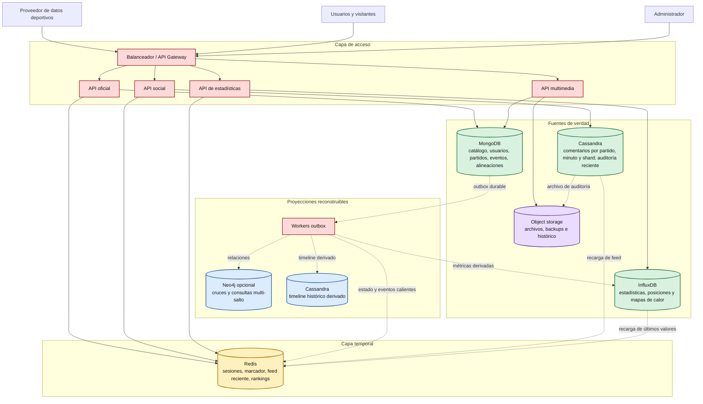
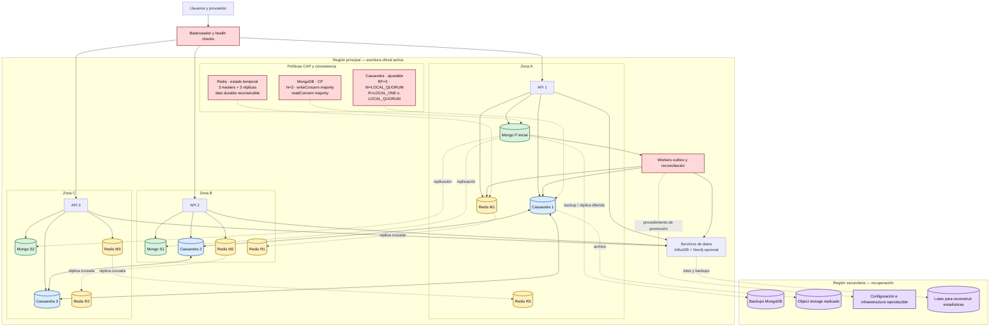
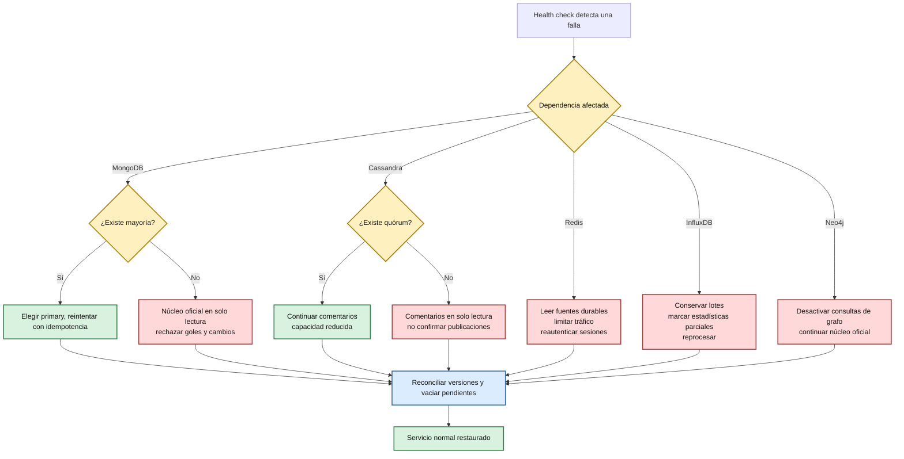

# Fixture 2030 — Diagramas de arquitectura distribuida

**Estado:** propuesta para validación  
**Versión:** 1.0  
**Fecha:** 2 de noviembre de 2026  
**Documento base:** `04_arquitectura_distribuida_cap_consistencia.md`

---

## 1. Propósito

Este documento representa visualmente las decisiones de arquitectura de Fixture 2030. Los diagramas deben permitir reconstruir:

- Qué motor es fuente de verdad.
- Qué componentes son temporales o reconstruibles.
- Cómo se propagan los datos.
- Cuántas réplicas tiene cada subsistema.
- Qué nodo puede escribir durante una partición.
- Qué se degrada durante una semifinal o final.
- Qué continúa funcionando cuando una dependencia falla.

Se incluyen tres vistas complementarias:

1. Arquitectura funcional y propiedad del dato.
2. Topología distribuida, nodos y réplicas.
3. Fallos, degradación y prioridades.

---

## 2. Leyenda de responsabilidades

| Color conceptual | Responsabilidad | Consecuencia de una caída |
|---|---|---|
| Verde | Fuente de verdad durable | La operación no se confirma sin la garantía definida. |
| Amarillo | Fuente temporal o caché | Se reconstruye o produce una consecuencia controlada. |
| Azul | Proyección durable derivada | Puede quedar atrasada y reprocesarse. |
| Violeta | Archivo o recuperación | No participa en el camino de baja latencia. |
| Rojo | Control, validación o coordinación | Protege consistencia, prioridad y degradación. |

Las flechas continuas representan operaciones principales. Las flechas punteadas representan propagación asíncrona, reconstrucción o recuperación.

---

## 3. Diagrama 1 — Arquitectura funcional y propiedad del dato

### 3.1 Pregunta que responde

¿Dónde nace cada dato, cuál es su fuente oficial y qué copias pueden reconstruirse?



### 3.2 Lectura del diagrama

#### Núcleo oficial

MongoDB es la fuente oficial de:

- Equipos.
- Jugadores.
- Usuarios.
- Fixture.
- Partido.
- Marcador.
- Alineaciones.
- Sustituciones.
- Eventos oficiales.

El proveedor no escribe directamente en Redis, Cassandra, Neo4j ni InfluxDB. Envía comandos a la API, que valida y persiste la operación oficial.

#### Interacción social

Cassandra es la fuente durable de los comentarios. Redis conserva:

- Páginas recientes.
- Contadores.
- Rate limits.
- Deduplicación temporal.

Si Redis pierde esas claves, el feed se reconstruye desde Cassandra.

#### Estadísticas

InfluxDB conserva las series temporales. Redis puede mantener el último valor, pero no reemplaza el detalle ni los agregados históricos.

#### Proyecciones

El patrón `outbox` evita escribir en varios motores dentro de la transacción oficial. Los workers actualizan de manera idempotente:

- Redis.
- Cassandra histórica.
- Neo4j.
- InfluxDB, cuando se trate de métricas derivadas.

Neo4j y el timeline histórico no deciden si el evento ocurrió. Pueden atrasarse o reconstruirse.

#### Multimedia y archivo

MongoDB conserva metadatos. El object storage conserva archivos, backups y auditoría histórica. No participa en el camino de baja latencia del marcador.

### 3.3 Reglas que deben mantenerse

1. Un gol nunca existe únicamente en Redis.
2. Un comentario nunca se confirma únicamente en caché.
3. Una proyección atrasada no bloquea la fuente oficial.
4. Cada consumidor utiliza `event_id`, secuencia y versión para evitar duplicados.
5. La API informa timestamp y versión cuando sirve datos potencialmente atrasados.

---

## 4. Diagrama 2 — Topología distribuida, nodos y réplicas

### 4.1 Pregunta que responde

¿Cómo se distribuyen los nodos entre zonas y qué mayoría necesita cada motor?



### 4.2 MongoDB

```text
Miembros: 3
Primary: 1, sujeto a elección
Secondaries: 2
writeConcern: majority
readConcern oficial: majority
```

Comportamiento:

- Tolera la caída de un miembro.
- Si cae el primary, se elige uno nuevo entre los secondaries.
- Si queda un solo miembro aislado, no acepta operaciones oficiales.
- La letra `P` indica el primary inicial, no una asignación permanente a la Zona A.

### 4.3 Cassandra

```text
Nodos: 3 como base
Factor de réplica: 3
Publicación: LOCAL_QUORUM
Feed público: LOCAL_ONE
Moderación: LOCAL_QUORUM
```

Comportamiento:

- Tolera la caída de un nodo manteniendo quórum.
- En una partición `2 + 1`, el lado de dos confirma publicaciones.
- El nodo aislado puede servir una lectura eventual, pero no confirma comentarios.
- Para una final, la capacidad puede crecer a más nodos manteniendo RF 3.

### 4.4 Redis

```text
Primarios: 3
Réplicas: 3
Distribución: una réplica cruzada por primario
Persistencia: AOF para sesiones
```

Comportamiento:

- Las sesiones se distribuyen por hash de `sesion_id`.
- El marcador se mantiene en claves pequeñas.
- Los comentarios recientes se segmentan por bucket y shard.
- Ante pérdida de una caché, se reconstruye desde la fuente durable.
- Ante pérdida de una sesión no replicada, se solicita reautenticación.

### 4.5 InfluxDB y Neo4j

El diagrama los agrupa como servicios cuya alta disponibilidad todavía debe validarse:

- InfluxDB 3 Core local no se presenta como clúster distribuido.
- Se deberá elegir una edición con HA o un pipeline durable que permita reproducir lotes.
- Neo4j solo permanece si las consultas justifican su costo.
- Si alguno cae, no se pierde el estado oficial del partido.

### 4.6 Región secundaria

La región secundaria no acepta escrituras oficiales simultáneas en esta etapa. Conserva:

- Backups.
- Archivos replicados.
- Configuración.
- Lotes de recuperación.

La promoción requiere un procedimiento controlado para impedir dos escritores oficiales.

---

## 5. Diagrama 3 — Fallos y degradación controlada

### 5.1 Pregunta que responde

¿Qué hace Fixture 2030 cuando una dependencia cae durante un partido de alta demanda?



### 5.2 Orden de prioridad durante una final

| Prioridad | Funcionalidad | Comportamiento bajo saturación |
|---:|---|---|
| 1 | Evento oficial, estado y marcador | Se reservan conexiones, workers y capacidad. |
| 2 | Lectura pública del partido | Se sirve desde Redis o última versión confirmada. |
| 3 | Lectura de comentarios | Se mantienen páginas recientes y paginación limitada. |
| 4 | Publicación de comentarios | Se aplica rate limit; requiere quórum Cassandra. |
| 5 | Likes, contadores y rankings | Se consolidan con menor frecuencia. |
| 6 | Neo4j y proyecciones no críticas | Se posponen hasta recuperar capacidad. |

### 5.3 Escenarios visibles en el diagrama

#### MongoDB sin mayoría

- No se registra un gol.
- No se confirma una sustitución.
- No se cambia el estado del partido.
- Redis muestra la última versión con timestamp.
- El proveedor reintenta con la misma `idempotency_key`.

#### Cassandra sin quórum

- No se responde `201 Created` para nuevos comentarios.
- Redis puede continuar mostrando comentarios ya confirmados.
- El módulo social pasa a solo lectura.
- El partido, marcador y estadísticas continúan.

#### Redis caído

- MongoDB conserva el estado oficial.
- Cassandra conserva comentarios.
- InfluxDB conserva estadísticas.
- La API aplica límites estrictos al fallback.
- Rankings y contadores pueden deshabilitarse.
- Las sesiones pueden requerir reautenticación.

#### InfluxDB caído

- Los lotes se conservan fuera de Redis.
- La API muestra `parcial` o `atrasado`.
- El timestamp original se mantiene al reprocesar.
- El partido continúa normalmente.

#### Neo4j caído

- Solo se pierden temporalmente consultas de varios saltos.
- El resto de los endpoints continúa.
- El checkpoint permite completar la proyección al recuperarse.

### 5.4 Recuperación común

Después de recuperar una dependencia:

1. Se comprueba la versión oficial.
2. Se reprocesa el `outbox` pendiente.
3. Se aplican mensajes idempotentes.
4. Se reconstruyen cachés.
5. Se compara el checkpoint de cada proyección.
6. Se reanudan funcionalidades por orden de prioridad.
7. Se registra evidencia del incidente y de la recuperación.

---

## 6. Laboratorio actual frente a arquitectura objetivo

| Componente | Laboratorio demostrado | Arquitectura objetivo del diagrama |
|---|---|---|
| API | Proceso FastAPI local | Tres o más instancias stateless detrás de balanceador. |
| MongoDB | Una instancia local con datos de catálogo | Replica set de tres miembros y mayoría. |
| Redis | Una instancia, AOF y TTL | Tres primarios, tres réplicas y distribución por slots. |
| Cassandra | Un nodo y RF 1 | Tres o más nodos, RF 3 y quórum. |
| InfluxDB | InfluxDB 3 Core local | HA soportada o pipeline durable reproducible. |
| Neo4j | Una instancia con grafo cargado | Proyección opcional con recuperación y HA si se justifica. |
| Object storage | Diseñado, no desplegado | Versionado, backups y réplica regional. |
| Región secundaria | No implementada | Recuperación y promoción controlada. |

Esta distinción debe aparecer junto a los diagramas en la entrega final. Evita presentar decisiones conceptuales como resultados ya demostrados.

---

## 7. Correspondencia con la devolución del profesor

| Observación docente | Respuesta visual |
|---|---|
| No se veían las réplicas | El Diagrama 2 muestra MongoDB P/S/S, Cassandra RF 3 y Redis 3+3. |
| No se veían agrupamientos | Los nodos están agrupados por zona y región. |
| No se veía CAP | El Diagrama 3 muestra mayoría, quórum y paso a solo lectura. |
| No se veía qué pasaba si caía un nodo | Se representa elección, continuidad con quórum y degradación. |
| No se reconstruían las decisiones escritas | Cada diagrama está acompañado por configuración y lectura guiada. |
| No se diferenciaba implementación de objetivo | La sección 6 compara laboratorio y arquitectura objetivo. |

---

## 8. Validaciones pendientes antes de congelar los diagramas

1. Confirmar con el profesor si exige despliegue multinodo real.
2. Definir la edición o recuperación objetivo de InfluxDB.
3. Resolver si Neo4j aporta consultas suficientes para permanecer.
4. Medir si Cassandra necesita 4, 8 o 16 shards en una final.
5. Definir los límites p95 y p99.
6. Validar RPO y RTO.
7. Elegir el transporte concreto del `outbox`.
8. Exportar los diagramas finales a SVG o PNG para la entrega.

---

## 9. Historial de cambios

### Versión 1.0 — 2 de noviembre de 2026

- Arquitectura funcional y propiedad del dato.
- Topología distribuida en tres zonas.
- Réplicas MongoDB, Cassandra y Redis representadas.
- Región secundaria diferenciada.
- Flujo de fallos y degradación controlada.
- Prioridades específicas para semifinal y final.
- Comparación entre laboratorio y arquitectura objetivo.

