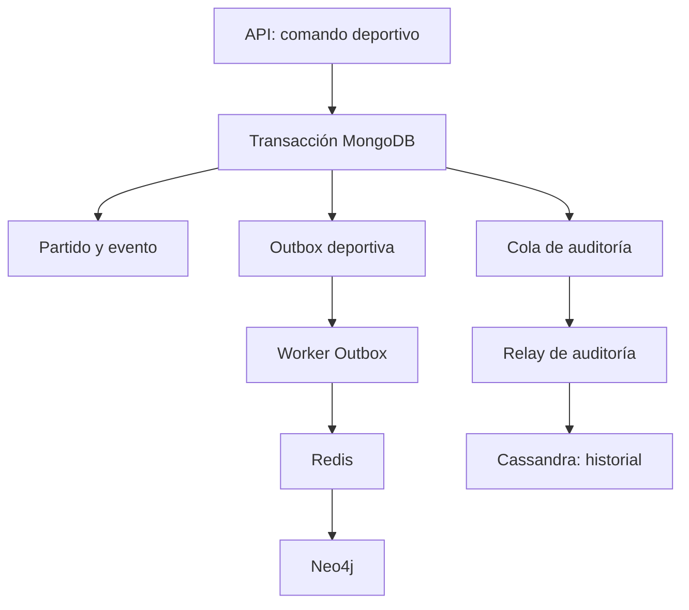
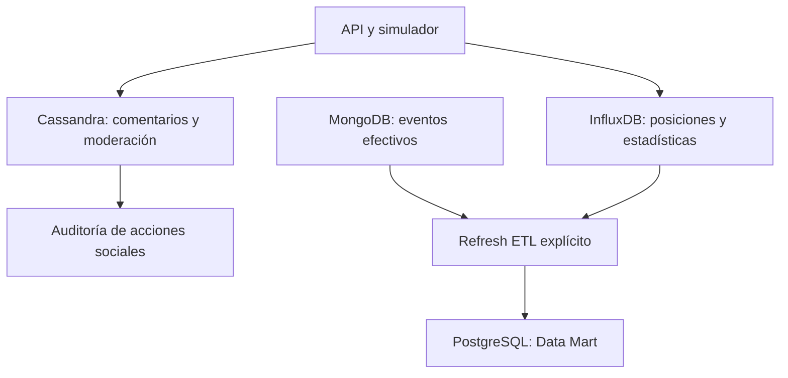
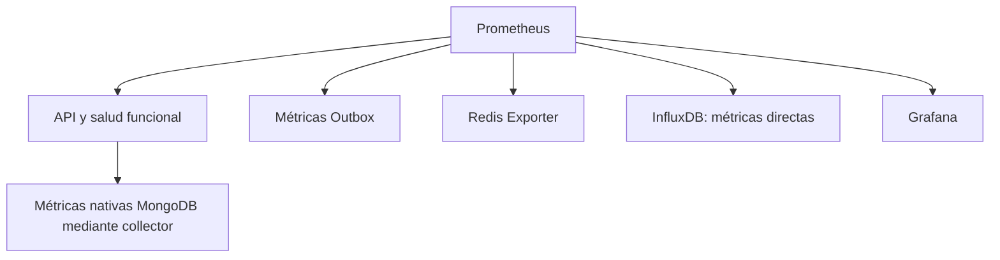

# Fixture 2030 — Diagramas de arquitectura

## Escritura oficial y entrega de proyecciones

El recorrido Redis → Neo4j expresa el orden de llamadas del worker, no una
replicación entre esos motores. Ambos reciben información del mensaje Outbox.
El hecho deportivo es oficial desde la confirmación MongoDB; el estado
`PUBLICADO` se registra después de completar los dos destinos. El relay de
auditoría es independiente y pertenece al incremento 15.

## Datos sociales, telemetría y analítica

Los comentarios permanecen en Cassandra. La telemetría permanece en InfluxDB.
El Data Mart recibe hechos y resúmenes mediante refresh; no mueve las fuentes
ni convierte MongoDB en repositorio de todas las muestras. El simulador escribe
posiciones y pelota; las estadísticas de equipo y sus resúmenes tienen rutas
de ingesta/agregación propias.

## Observabilidad

Las flechas desde Prometheus representan recolección; Grafana consulta
Prometheus para visualizar las series. Prometheus también se recolecta a sí
mismo. Cassandra, Neo4j y Data Mart se observan funcionalmente desde la API;
no se afirma disponer de métricas internas completas de esos motores.

## Topología y fallas

Cada motor tiene una instancia local con persistencia por volumen. La parada
de un contenedor puede degradar su función mientras otra lectura continúa.
La recuperación observada consiste en reiniciar el componente y comprobar su
salud y la convergencia que corresponda.

Un despliegue redundante requeriría varias réplicas, dominios de falla
independientes, políticas de elección/failover y restauración probada. No se
dibuja esa topología como parte del entorno ejecutado. La configuración local
y los resultados registrados se detallan en
[arquitectura y consistencia](04_arquitectura_distribuida_cap_consistencia.md) y
[estado de validación](../estado_validacion.md).
