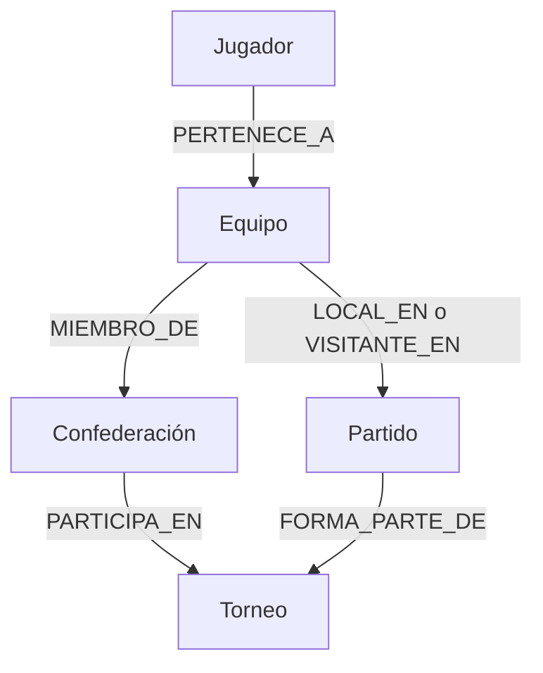

# 6.6 Modelo físico de Neo4j

## Responsabilidad y fuente

Neo4j es una proyección para relaciones y recorridos. MongoDB conserva la
autoridad sobre equipos, jugadores, partidos y eventos. La proyección inicial
se reconstruye de manera idempotente desde `data/catalogo/` y no inventa los
96 partidos de antecedentes históricos.

La rama `Neo` fue inspeccionada en el commit
`6c574ad704c6f3185246d78ed9cb07dc8c4146d1`: contiene una mezcla antigua de
MongoDB y no un módulo Neo4j reutilizable. Por eso se conservó solamente el
alcance académico de la Clase 5 y se construyó este adaptador sobre las
convenciones comunes.

## Modelo

| Nodo | Identidad | Propiedades principales |
|---|---|---|
| `Jugador` | `JUG-0001` | nombre, fecha de nacimiento, posición |
| `Equipo` | `EQ-01` | nombre, confederación, ranking |
| `Partido` | `PAR-0001` | inicio, estado, alcance |
| `Confederacion` | código oficial | nombre |
| `Torneo` | `TOR-2030` | nombre, año |

Cada vínculo corresponde a un recorrido real: plantel, pertenencia regional,
participación en el torneo o rol en un partido. No se almacenan coordenadas ni
estadísticas temporales, que pertenecen a InfluxDB.

## Restricciones, índices e idempotencia

Los cinco nodos oficiales poseen unicidad por `id`; `NodoDemo` tiene una
restricción separada para CRUD sin tocar el catálogo. Se indexan posición de
jugador y ranking de equipo. La carga usa `MERGE`, actualiza propiedades y
reemplaza relaciones de pertenencia cuando cambia su destino. Repetirla no
duplica nodos ni relaciones.

La línea base contiene 64 equipos, 1.024 jugadores, un partido, seis
confederaciones, un torneo y 1.097 relaciones. La carga rechaza cantidades
distintas o jugadores huérfanos.

## Consultas justificadas

- rivales: equipo → partido → otro equipo;
- recomendaciones: jugador → equipo → confederación → otro equipo → jugador;
- camino entre equipos: equipo → confederación → torneo → confederación → equipo;
- CRUD temporal: crea, lee, actualiza y elimina exclusivamente `NodoDemo`.

Las recomendaciones comparten posición y confederación y se ordenan por
diferencia de ranking. Es un criterio transparente de laboratorio, no un
modelo predictivo ni una afirmación de afinidad personal.

## API

- `GET /api/v1/grafo/resumen`
- `GET /api/v1/grafo/equipos/{equipoId}/rivales`
- `GET /api/v1/grafo/jugadores/{jugadorId}/recomendaciones`
- `GET /api/v1/grafo/equipos/{origenId}/camino/{destinoId}`

## Seguridad, persistencia y observabilidad

- imagen LTS fijada: `neo4j:5.26.34-community-trixie`;
- driver oficial fijado: `neo4j==6.4.1`;
- autenticación mediante Docker secrets generados en `.secretos/`;
- volúmenes nombrados para datos, logs e importaciones;
- Browser y Bolt publicados solo en `127.0.0.1`;
- salud funcional `fixture2030_dependency_up{dependency="neo4j"}`;
- operaciones `fixture2030_graph_operations_total`;
- alerta y falla controlada con continuidad del partido oficial.

La configuración de secretos sigue la guía oficial de Neo4j para
`NEO4J_AUTH_FILE`. Se eligió la versión 5.26 LTS en lugar de `latest` para que
la demostración sea reproducible.

## Límites

Community Edition y un solo contenedor permiten demostrar modelo, Cypher,
persistencia y recuperación del proceso, no clustering ni alta disponibilidad.
No se instala Graph Data Science: el Hito 5 exige un camino o análisis de
relaciones, cubierto aquí con `shortestPath` y recorridos Cypher nativos. La
actualización automática desde Outbox sigue pendiente del incremento de
integración; por ahora la proyección se reconstruye explícitamente.

Fuentes oficiales consultadas:

- https://neo4j.com/docs/operations-manual/current/docker/docker-compose-standalone/
- https://neo4j.com/docs/operations-manual/current/docker/introduction/
- https://neo4j.com/docs/python-manual/current/install/
