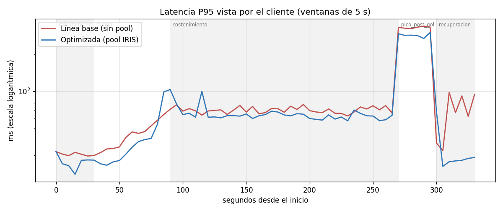
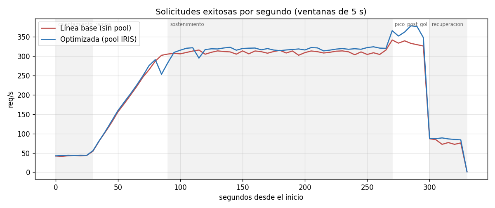
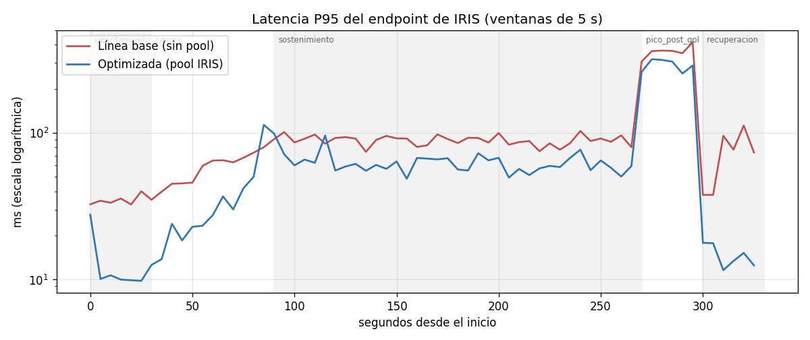
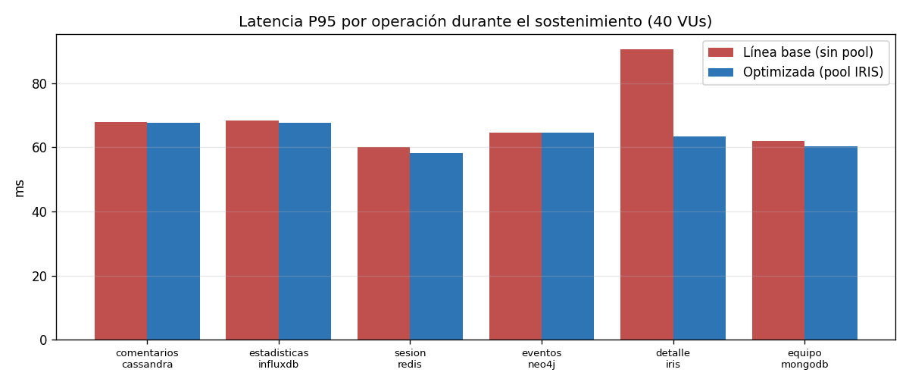
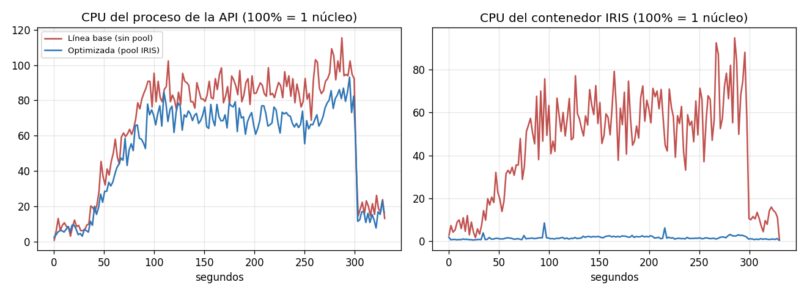

# Comparación línea base vs. optimizada

Generado por `scripts/comparar_resultados.py` el 2026-10-24T20:29:57-03:00.

| | Línea base | Optimizada |
|---|---|---|
| Corrida | `linea_base_20261024-201624` | `optimizada_20261024-202348` |
| Commit API | `542a1d8` (modificado sin commit: False) | `542a1d8` (modificado sin commit: False) |
| IRIS_POOL_SIZE | 0 | 5 |
| Inicio | 2026-10-24T20:16:24-03:00 | 2026-10-24T20:23:48-03:00 |
| Corte seguro | no | no |

**Condiciones equivalentes:** escenario ✔, fases ✔, mezcla ✔, semilla ✔, procesos_generador ✔, catalogo_claves ✔

## 1. Resultado global (fases medidas: rampa + sostenimiento + pico + recuperación)

| Métrica | Línea base | Optimizada | Variación |
|---|---:|---:|---:|
| Solicitudes | 79201 | 81554 | +3.0% |
| Exitosas | 79201 | 81554 | +3.0% |
| Tasa de error % | 0.0 | 0.0 | - |
| Throughput (req/s) | 264.0 | 271.85 | +3.0% |
| Latencia P50 (ms) | 31.5 | 28.13 | -10.7% |
| Latencia P95 (ms) | 135.16 | 124.4 | -8.0% |
| Latencia P99 (ms) | 292.31 | 256.13 | -12.4% |
| Latencia máx (ms) | 958.55 | 1021.4 | +6.6% |
| Tiempo en API P50 (ms) | 9.98 | 8.42 | -15.6% |
| Tiempo en API P95 (ms) | 36.94 | 23.38 | -36.7% |

## 2. Por fase

| Fase | VUs | req/s antes | req/s después | P95 antes | P95 después | Var. P95 | P99 antes | P99 después | errores antes/después |
|---|---:|---:|---:|---:|---:|---:|---:|---:|---|
| calentamiento | 5→5 | 42.67 | 43.53 | 30.73 | 26.42 | -14.0% | 35.13 | 33.74 | 0 / 0 |
| rampa | 5→40 | 185.28 | 184.33 | 50.7 | 47.24 | -6.8% | 68.63 | 80.86 | 0 / 0 |
| sostenimiento | 40→40 | 309.62 | 316.69 | 70.28 | 64.84 | -7.7% | 92.86 | 90.11 | 0 / 0 |
| pico_post_gol | 80→80 | 334.07 | 363.97 | 332.61 | 286.61 | -13.8% | 476.97 | 432.12 | 0 / 0 |
| recuperacion | 10→10 | 77.7 | 85.7 | 65.99 | 26.75 | -59.5% | 207.05 | 36.01 | 0 / 0 |

## 3. Por operación durante el sostenimiento (40 VUs, 180 s)

| Operación | P50 antes | P50 después | P95 antes | P95 después | Var. P95 | API P50 antes | API P50 después | Var. API P50 |
|---|---:|---:|---:|---:|---:|---:|---:|---:|
| comentarios_cassandra | 31.99 | 31.74 | 67.88 | 67.71 | -0.3% | 13.01 | 13.13 | +0.9% |
| estadisticas_influxdb | 30.65 | 29.87 | 68.43 | 67.64 | -1.2% | 11.51 | 11.2 | -2.7% |
| sesion_redis | 22.26 | 21.85 | 60.14 | 58.11 | -3.4% | 3.04 | 2.98 | -2.0% |
| eventos_neo4j | 25.06 | 24.74 | 64.52 | 64.54 | +0.0% | 5.66 | 5.5 | -2.8% |
| detalle_iris | 53.06 | 24.56 | 90.66 | 63.39 | -30.1% | 34.09 | 5.42 | -84.1% |
| equipo_mongodb | 23.66 | 22.82 | 61.9 | 60.44 | -2.4% | 4.25 | 3.87 | -8.9% |

## 4. Recursos (promedio por fase, muestreo cada 2 s; CPU 100% = 1 núcleo)

| Fase | CPU API antes | CPU API después | CPU IRIS antes | CPU IRIS después | CPU generador antes | CPU generador después | RAM sistema % antes/después | lag loop máx ms antes/después |
|---|---:|---:|---:|---:|---:|---:|---|---|
| calentamiento | 7.8 | 5.8 | 6.4 | 0.9 | 12.3 | 12.0 | 74.3 / 75.3 | 32.4 / 33.2 |
| rampa | 46.2 | 36.0 | 30.9 | 1.4 | 76.5 | 74.0 | 74.3 / 76.0 | 27.9 / 30.3 |
| sostenimiento | 86.1 | 70.1 | 58.0 | 1.9 | 172.6 | 164.8 | 74.4 / 76.8 | 26.4 / 28.3 |
| pico_post_gol | 98.0 | 81.7 | 66.0 | 2.4 | 370.3 | 367.0 | 74.4 / 76.6 | 21.4 / 19.7 |
| recuperacion | 20.5 | 17.2 | 10.4 | 1.0 | 31.4 | 35.6 | 74.6 / 76.9 | 32.4 / 32.9 |

## 5. Integridad

| Chequeo | Línea base | Optimizada |
|---|---|---|
| sin_request_id_duplicados | OK | OK |
| sin_respuestas_alteradas | OK | OK |
| api_registro_todas_las_respuestas | OK | OK |
| mismo_codigo_http_cliente_y_api | OK | OK |
| catalogo_identico_tras_la_carga | OK | OK |
| redis_sesiones_completas | OK | OK |
| iris_partidos_completos | OK | OK |
| cassandra_comentarios_completos | OK | OK |
| solicitudes generadas / exitosas y correctas | 80481 / 80481 | 82860 / 82860 |

## 6. Repeticiones (todas las corridas completas con el generador de 4 procesos)

| Corrida | Pool IRIS | req/s | P95 global | P95 sostenimiento | P95 pico | Máx | IRIS API P50 (sost.) | IRIS P95 (sost.) | error % | integridad |
|---|---:|---:|---:|---:|---:|---:|---:|---:|---:|---|
| `linea_base_20261024-195501` | 0 | 265.75 | 135.39 | 69.89 | 325.84 | 920.63 | 33.85 | 89.12 | 0.0 | True |
| `linea_base_20261024-201624` | 0 | 264.0 | 135.16 | 70.28 | 332.61 | 958.55 | 34.09 | 90.66 | 0.0 | True |
| `optimizada_20261024-200735` | 5 | 266.88 | 119.88 | 62.73 | 312.27 | 4509.83 | 5.26 | 58.72 | 0.0 | True |
| `optimizada_20261024-202348` | 5 | 271.85 | 124.4 | 64.84 | 286.61 | 1021.4 | 5.42 | 63.39 | 0.0 | True |

## 7. Gráficos

