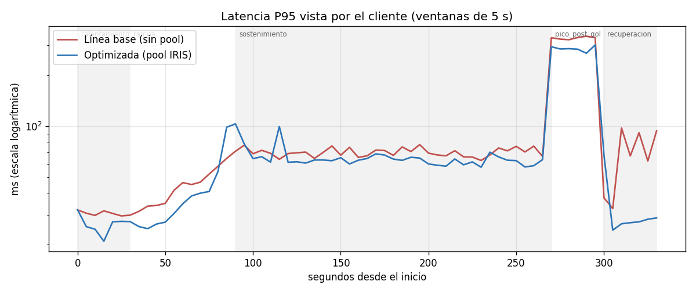
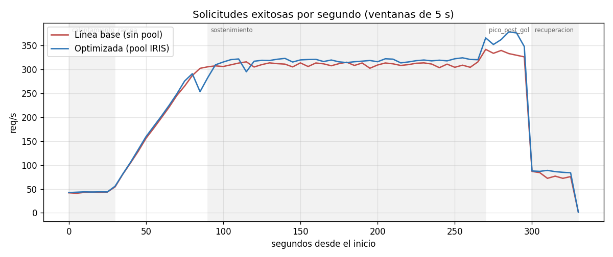
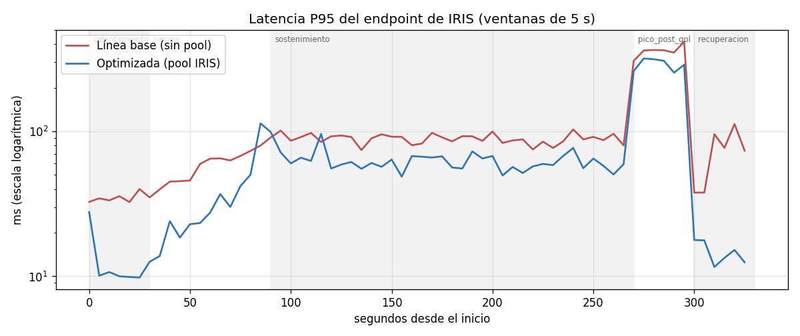
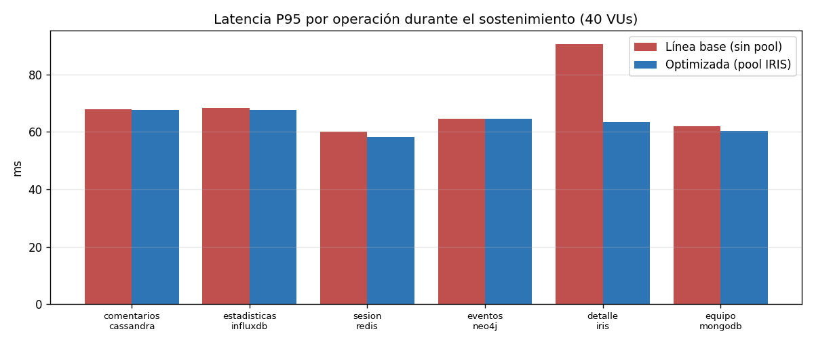
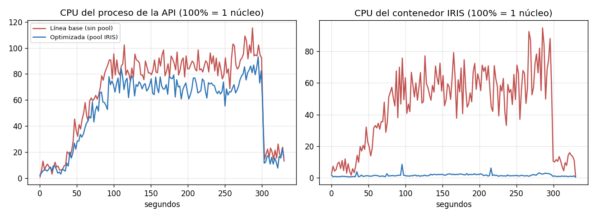

# Tablas y gráficos del Hito 12

Índice generado por `scripts/resumir_evidencia.py` el 2026-10-24T20:46:29-03:00.

## 1. Comparación antes / después

Tablas completas (global, por fase, por operación, recursos, integridad y repeticiones): [`comparacion/comparacion.md`](comparacion/comparacion.md) · datos: [`comparacion/comparacion.json`](comparacion/comparacion.json)

### Latencia P95 en el tiempo (todas las operaciones)

### Throughput en el tiempo

### Latencia P95 del endpoint de IRIS en el tiempo

### P95 por operación durante el sostenimiento

### CPU de la API y del contenedor IRIS

## 2. Diagnóstico de la hipótesis (directo contra IRIS)

| Escenario | Hilos | ops/s | connect() ms | consulta ms | P50 ms | P95 ms | Errores |
|---|---:|---:|---:|---:|---:|---:|---|
| A1 conexion por operacion, 1 hilo | 1 | 45.2 | 19.1 | 2.96 | 22.02 | 22.95 | - |
| B1 conexion reutilizada, 1 hilo | 1 | 815.6 | 0.0 | 1.21 | 1.2 | 1.31 | - |
| A20 conexion por operacion, 20 hilos | 20 | 223.8 | 81.92 | 3.63 | 81.89 | 105.57 | - |
| B20 pool de 5 conexiones, 20 hilos | 20 | 3188.5 | 0.0 | 1.49 | 1.44 | 56.64 | - |

Conexiones simultáneas aceptadas por IRIS Community: **8** (rechazo: Unable to allocate a license). Fuente: [`diagnostico_iris.json`](diagnostico_iris.json)

## 3. Data Mart

| Conteo | Fuente | Destino |
|---|---:|---:|
| Comentarios | 28809 | 28809 |
| Eventos | 192 | 192 |
| Partidos | 96 | 96 |

Validaciones: {'comentarios_fuente_igual_destino': True, 'eventos_fuente_igual_destino': True, 'una_fila_por_partido_y_ventana': True, 'sin_hechos_huerfanos': True} · Observaciones de calidad: {'equipos_con_nombre_distinto_neo4j_vs_mongo': 64, 'partidos_con_fecha_neo4j_distinta_al_dia_de_actividad': 92, 'filas_influx_con_equipo_no_conciliado': 9}

| Camino | Operaciones | Tiempo (mediana) |
|---|---:|---:|
| Fuentes operacionales vía API | 1536 llamadas HTTP | 8723.4 ms |
| Data Mart (SQLite) | 2 consultas SQL | 0.574 ms |

Misma respuesta en ambos caminos: **sí**. Fuentes: [`data_mart_construccion.json`](data_mart_construccion.json), [`data_mart_comparacion.json`](data_mart_comparacion.json)

## 4. Resultados por corrida

- [`resultados_linea_base.md`](resultados_linea_base.md)
- [`resultados_optimizados.md`](resultados_optimizados.md)
- Capturas de consola: [`capturas_redactadas/`](capturas_redactadas/)

