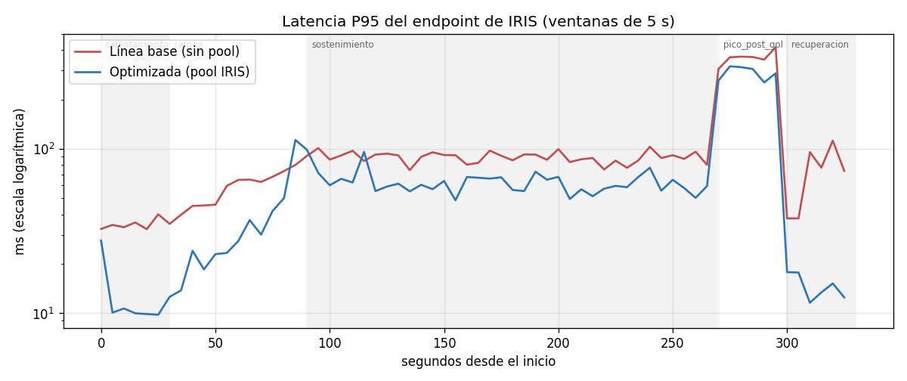
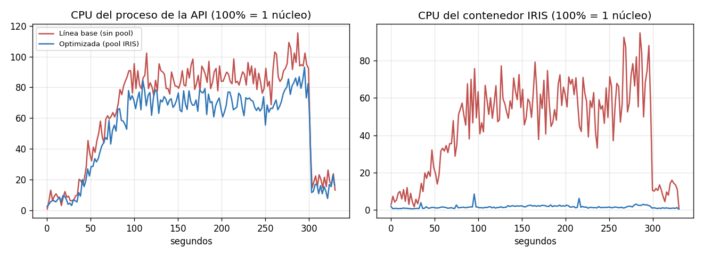

# Hipótesis de cuello de botella, optimización y comparación (RF7–RF11, puntos 5.5 y 5.6)

## 1. Problema observado

En la línea base (ver `linea_base.md`):

- El endpoint de **IRIS** es el más lento **dentro de la API**: P50 = 33,9 ms, contra 3–13 ms de las otras cinco operaciones.
- El contenedor de IRIS consume **57–70 % de CPU** para atender ~31 req/s, más que cualquier otra base con más tráfico.
- El proceso de la API está al **85 % de un núcleo con 40 VUs y al 94–106 % con 80 VUs**, y es el límite del sistema. Cualquier trabajo innecesario dentro de la API le quita capacidad a las seis operaciones.

## 2. Hipótesis

> El adaptador de IRIS (`app/adapters/iris.py`) **abre y cierra una conexión nueva en cada solicitud** (lo documentó el propio Hito 10). Abrir una conexión con el Superserver de IRIS (handshake, autenticación, selección de namespace y creación del proceso del lado del servidor) cuesta mucho más que las tres consultas SQL que hace el endpoint. Ese costo (1) agrega latencia a cada lectura de IRIS, (2) consume CPU del contenedor IRIS y (3) consume CPU del proceso de la API, que es el recurso saturado. **Si las conexiones se reutilizan, el tiempo de IRIS dentro de la API debería bajar a pocos milisegundos, la CPU de IRIS debería caer fuertemente y la API debería tener más margen para el resto de las operaciones.**

Hipótesis alternativas que se descartaron con la evidencia:

| Alternativa | Por qué se descarta |
|---|---|
| Las consultas SQL de IRIS son lentas (faltan índices) | `Codigo` y `Partido` tienen índice (`idxCodigo`, `idxPartido`) y el diagnóstico mide 3 ms de consulta (sección 3) |
| El generador limita | Corregido en v1; en v2 usa 3,7 de 12 núcleos y su event loop no se atrasa |
| La red local limita | Las otras operaciones, por la misma red, tardan 3–13 ms dentro de la API |

## 3. Prueba de la hipótesis: diagnóstico directo contra IRIS

`scripts/diagnostico_iris.py` repite las consultas del endpoint **sin pasar por la API** y separa el tiempo de `connect()` del de las consultas. 200 operaciones por escenario, 24/10/2026 20:01 (`docs/evidencia/diagnostico_iris.json`):

| Escenario | Hilos | ops/s | `connect()` prom. | Consultas prom. | P50 total | P95 total | Errores |
|---|---:|---:|---:|---:|---:|---:|---|
| A1 — conexión nueva por operación (como la API) | 1 | 45,2 | **19,1 ms** | 2,96 ms | 22,0 ms | 23,0 ms | 0 |
| B1 — conexión reutilizada | 1 | 815,6 | 0 | 1,21 ms | **1,2 ms** | 1,3 ms | 0 |
| A20 — conexión nueva por operación | 20 | 223,8 | **81,9 ms** | 3,63 ms | 81,9 ms | 105,6 ms | 0 |
| B20 — pool de 5 conexiones compartidas | 20 | **3.188,5** | 0 | 1,49 ms | 1,4 ms | 56,6 ms | 0 |
| C — conexiones simultáneas que acepta IRIS Community | — | — | — | — | — | — | **8**, la 9.ª: *Unable to allocate a license* |

Conclusiones:

- **El 87 % del tiempo** de una operación con conexión nueva es abrir la conexión (19,1 de 22 ms). Con concurrencia, el costo de conectar se multiplica por 4 (82 ms).
- Reutilizando conexiones, el mismo trabajo es **18 veces más rápido** secuencial y **14 veces más rápido** con 20 hilos.
- **Restricción descubierta:** la edición Community de IRIS **no acepta más de 8 conexiones simultáneas**. El primer intento del diagnóstico, que intentaba abrir 20 conexiones persistentes, se interrumpió con ese error (captura `evidencia/capturas_redactadas/04_diagnostico_iris_limite_licencias.png`). Por eso el escenario B20 final usa un pool de 5 y el escenario C mide el límite exacto. Esto acota el tamaño del pool.
- En B20, el P95 sube a 56,6 ms: con 20 hilos y 5 conexiones, algunos hilos esperan una conexión libre. Es el costo de un pool chico.

La hipótesis queda **confirmada** a nivel del motor. Falta verificar el efecto en el sistema completo bajo carga (sección 5).

## 4. Cambio implementado

| Aspecto | Detalle |
|---|---|
| Problema que resuelve | Costo de abrir una conexión con IRIS en cada solicitud |
| Cambio | Pool de conexiones reutilizables en el adaptador de IRIS (LIFO, creación perezosa, hasta `IRIS_POOL_SIZE` conexiones) |
| Archivos | `app/adapters/iris.py` (`_acquire`, `_release`, `close`), `app/config/settings.py` (`iris_pool_size: int = 0`), `.env.example` |
| Commit | `542a1d8` — "Hito 12 - Pool de conexiones reutilizables en el adaptador de IRIS" |
| Configuración usada | `IRIS_POOL_SIZE=5` (la fija `ejecutar_prueba_optimizada.ps1`) |
| Compatibilidad | Con `IRIS_POOL_SIZE=0` (valor por defecto) la API se comporta exactamente como antes. Así se midió la línea base 2 |

Comportamiento del pool:

1. Si hay una conexión libre, se usa (la más reciente: LIFO, para no reactivar conexiones que llevan más tiempo ociosas).
2. Si no hay libre pero hay cupo (< 5 creadas), se abre una nueva.
3. Si las 5 están en uso, la solicitud **espera** hasta el timeout de dependencias (5 s). Si no se libera ninguna, responde **504** (`DependencyTimeoutError`) en lugar de colgarse o de abrir más conexiones de las que IRIS admite.
4. Si una consulta falla con un error del driver, esa conexión **no vuelve al pool**: se cierra y se libera su cupo. Así una conexión rota no contamina las siguientes solicitudes.
5. `/health/ready` (`ping`) sigue abriendo su propia conexión a propósito, para verificar que IRIS acepte conexiones nuevas.

Prueba unitaria hecha antes de medir (IRIS simulado): 300 solicitudes con 30 hilos y pool de 3 → 3 conexiones creadas, nunca más de 3 simultáneas, todas las respuestas correctas. Dos fallas forzadas → las 2 conexiones se descartaron y se recrearon. `close()` cerró todas.

**Por qué 5:** IRIS acepta 8 en total (medido). Se dejan 3 libres para `/health/ready`, el diagnóstico, el portal de administración o una terminal. Con 40 hilos de la API compitiendo, 5 conexiones alcanzan porque cada una queda ocupada ~5 ms (sección 5): 5 conexiones atienden en teoría ~1.000 req/s de IRIS y la prueba pide ~36 req/s.

## 5. Repetición en las mismas condiciones (RF9, RNF3)

Mismo escenario, catálogo, semilla, hardware y procedimiento (reinicio de la API antes de cada corrida). Lo único que cambia es `IRIS_POOL_SIZE` (0 → 5). `comparar_resultados.py` verifica automáticamente que coincidan escenario, fases, mezcla, semilla, procesos del generador y catálogo (todas ✔).

| Corrida | Commit | Pool | Inicio |
|---|---|---:|---|
| `linea_base_20261024-195501` | `657a285` | 0 | 19:55 |
| `optimizada_20261024-200735` | `542a1d8` | 5 | 20:07 |
| `linea_base_20261024-201624` | `542a1d8` | 0 | 20:16 |
| `optimizada_20261024-202348` | `542a1d8` | 5 | 20:23 |

Las corridas se intercalaron (base, optimizada, base, optimizada) para que una deriva del entorno a lo largo de la tarde no favorezca a una sola versión.

## 6. Comparación antes / después (RF10)

### 6.1 Operación optimizada: IRIS, durante el sostenimiento (40 VUs, 180 s)

| Métrica | LB1 | LB2 | OPT1 | OPT2 | Variación (prom.) |
|---|---:|---:|---:|---:|---:|
| Tiempo dentro de la API P50 | 33,9 | 34,1 | 5,3 | 5,4 | **−84 %** |
| Latencia cliente P50 | 52,6 | 53,1 | 24,1 | 24,6 | **−54 %** |
| Latencia cliente P95 | 89,1 | 90,7 | 58,7 | 63,4 | **−32 %** |
| CPU del contenedor IRIS | 56,8 % | 58,0 % | 2,5 % | 1,9 % | **−96 %** |

### 6.2 Sistema completo (todas las operaciones)

| Métrica | LB1 | LB2 | OPT1 | OPT2 | Variación (prom.) |
|---|---:|---:|---:|---:|---:|
| Throughput global medido (req/s) | 265,8 | 264,0 | 266,9 | 271,9 | +1,7 % |
| P50 global | 30,6 | 31,5 | 27,8 | 28,1 | −10 % |
| P95 global | 135,4 | 135,2 | 119,9 | 124,4 | −10 % |
| P99 global | 285,2 | 292,3 | 264,5 | 256,1 | −10 % |
| P95 dentro de la API | 36,0 | 36,9 | 26,0 | 23,4 | −32 % |
| **Sostenimiento** — req/s | 311,3 | 309,6 | 317,9 | 316,7 | +2,1 % |
| Sostenimiento — P95 | 69,9 | 70,3 | 62,7 | 64,8 | −9 % |
| Sostenimiento — CPU API | 85,3 % | 86,1 % | 69,4 % | 70,1 % | **−19 %** |
| **Pico** (80 VUs) — req/s | 333,9 | 334,1 | 306,9 * | 364,0 | +9 % (OPT2) |
| Pico — P95 | 325,8 | 332,6 | 312,3 * | 286,6 | −13 % (OPT2) |
| Pico — CPU API | 93,7 % | 98,0 % | 70,1 % * | 81,7 % | −15 % (OPT2) |
| Errores | 0 | 0 | 0 | 0 | — |
| Integridad (8 controles) | OK | OK | OK | OK | — |

Latencias en ms. \* OPT1 tuvo un congelamiento de ~4 s de la API en t≈276 s, dentro del pico (todas las operaciones quedaron detenidas a la vez, incluido Redis, y la CPU de la API cayó a 0). Esa ventana arrastra el throughput, el P99 (614 ms) y el máximo (4.510 ms) de OPT1. El mismo fenómeno ocurrió en la v1 sin pool, así que no se atribuye al cambio. Para el pico se toma OPT2 como referencia; ver `integridad_y_limitaciones.md`.

### 6.3 Efecto sobre las otras operaciones (sostenimiento, P95 cliente)

| Operación | LB1 / LB2 | OPT1 / OPT2 | Variación |
|---|---:|---:|---:|
| Comentarios — Cassandra | 67,6 / 67,9 | 65,8 / 67,7 | −1 % |
| Estadísticas — InfluxDB | 67,5 / 68,4 | 65,3 / 67,6 | −2 % |
| Sesión — Redis | 56,7 / 60,1 | 58,2 / 58,1 | ≈ 0 % |
| Eventos — Neo4j | 64,9 / 64,5 | 61,0 / 64,5 | −3 % |
| Equipo — MongoDB | 62,7 / 61,9 | 60,5 / 60,4 | −3 % |

Las demás operaciones mejoran poco (0–3 %, dentro de la variación entre corridas) porque su tiempo está dominado por la cola de entrada a la API, que sigue siendo un único proceso.

### 6.4 Interpretación

- **Mejoró lo que la hipótesis predijo:** el tiempo de IRIS dentro de la API (−84 %) y la CPU de IRIS (−96 %). El servidor IRIS pasó a estar prácticamente ocioso.
- **Se liberó CPU de la API** (−19 % en el sostenimiento). Con la misma carga, la API tiene más margen: en el pico de la OPT2 atendió 364 req/s con 82 % de CPU, contra 334 req/s con 94–98 % en la línea base.
- **El throughput global casi no cambia** (+2 % en el sostenimiento). Es esperable en un modelo cerrado: cada VU espera su respuesta y piensa 100 ms en promedio, así que el ritmo lo fijan VUs y think time mientras la API no esté saturada. La ganancia aparece como **menor latencia y más margen**, y se vuelve throughput solo cuando la API está al límite (pico de OPT2: +9 %).
- **Regresiones:** ninguna sistemática. El P99 del pico en OPT1 empeoró por el congelamiento, que no se repitió en OPT2.
- **El cuello de botella del sistema se mueve** pero no desaparece: sigue siendo el proceso único de la API (82 % en el pico de OPT2), ahora con IRIS fuera del camino crítico.

Tablas y gráficos completos: [`evidencia/comparacion/comparacion.md`](evidencia/comparacion/comparacion.md).

## 7. Costos, riesgos y trade-offs (RF11)

| Trade-off | Detalle | Mitigación |
|---|---|---|
| **Licencias / cupo de conexiones** | Las 5 conexiones del pool ocupan 5 de las 8 que admite IRIS Community **de forma permanente** mientras la API está levantada. Si se levantan varias instancias de la API (por ejemplo `uvicorn --workers 4` para escalar la API, el siguiente cuello), **cada proceso tendría su propio pool** y 4 × 5 = 20 superaría el límite: las solicitudes de IRIS empezarían a fallar | Repartir el cupo (pool = 1 o 2 por proceso), o licencia de IRIS con más conexiones en producción |
| Espera por conexión | Con más solicitudes de IRIS simultáneas que conexiones, las solicitudes esperan (en el diagnóstico B20, P95 = 56,6 ms). Si esperan más de 5 s, se devuelve 504 | Dimensionar el pool según la tasa de IRIS; el timeout evita colgarse |
| Conexiones viejas o rotas | Si IRIS se reinicia, las conexiones del pool quedan inválidas. La primera solicitud que use cada una falla (503) y recién ahí se descarta | Se podría validar con `SELECT 1` antes de usar (cuesta un viaje de ida y vuelta) o fijar un tiempo máximo de vida. No se implementó para no sumar latencia |
| Memoria y procesos en IRIS | 5 procesos de IRIS quedan vivos aunque no haya tráfico | Costo bajo; el pool es perezoso y no abre conexiones hasta que hacen falta |
| Complejidad del código | +75 líneas, manejo de concurrencia (lock, cola) y de errores | Interruptor `IRIS_POOL_SIZE=0` para volver al comportamiento anterior sin redeploy de código |
| Estado compartido entre solicitudes | Una conexión reutilizada conserva estado de sesión (por ejemplo, transacciones abiertas). El endpoint es de solo lectura y cierra el cursor siempre | Si se agregan escrituras, asegurar `commit`/`rollback` antes de devolver la conexión |

## 8. Decisión del equipo

Se **adopta** el pool con `IRIS_POOL_SIZE=5` para la API de una sola instancia, porque:

1. La mejora es grande, repetible y está en la operación que la hipótesis señalaba (−84 % de tiempo de IRIS en las dos corridas).
2. No introduce errores ni afecta la integridad (8/8 controles en todas las corridas).
3. Libera CPU del recurso que limita el sistema (la API).
4. Es reversible con una variable de entorno.

Queda documentado que, **si se escala la API a varios procesos, hay que bajar el pool por proceso** para no superar las 8 conexiones de IRIS Community.

## 9. Otras optimizaciones consideradas y no aplicadas

| Idea | Motivo para no aplicarla en este hito |
|---|---|
| `uvicorn --workers N` (varios procesos de API) | Ataca el nuevo cuello (CPU de un proceso), pero con el pool choca con el límite de 8 conexiones de IRIS y cambia toda la arquitectura de ejecución. Es el **próximo paso** natural, a medir por separado |
| Caché en Redis del detalle de partido de IRIS | Un partido finalizado no cambia, así que sería cacheable, pero suma invalidación y riesgo de datos viejos. Con el pool, IRIS ya no es el cuello |
| Bajar el nivel de log por solicitud | Cada solicitud escribe una línea de log de forma sincrónica en el event loop. Es candidato para explicar los congelamientos (ver limitaciones), pero se pierde trazabilidad (la validación cruza `request_id` con el log) |
| Escritura de comentarios por lotes | El flujo elegido es de lectura |

Se aplicó **un solo cambio** a la vez, como pide la metodología de la Clase 13, para poder atribuirle la diferencia medida.
