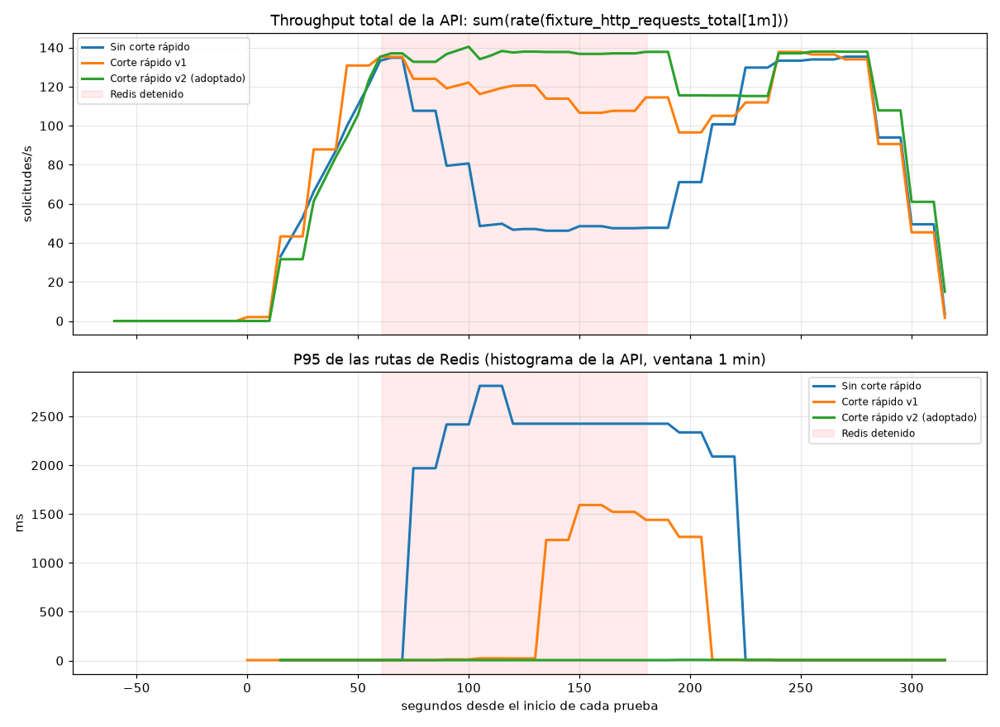

# Comparación: falla de Redis sin y con corte rápido

Generado por `scripts/comparar_pruebas.py` a partir de las carpetas `prueba_de_falla_redis_corte*`. Mismo escenario en las tres corridas: 20 usuarios virtuales constantes, mezcla del Hito 12, 60 s normales, Redis detenido 120 s (`docker stop`) y 90 s de recuperación, misma notebook y mismos datos. Una corrida por versión (ver limitaciones).

| Métrica (medida) | Sin corte rápido | Corte rápido v1 | Corte rápido v2 (adoptado) |
|---|---:|---:|---:|
| Throughput total ANTES de la falla (req/s) | 132.7 | 132.7 (+0 %) | 135.3 (+2 %) |
| **Throughput total DURANTE la falla (req/s)** | 47.1 | 115.2 (+145 %) | 137.7 (+192 %) |
| Throughput total DESPUÉS de la falla (req/s) | 134.3 | 135.6 (+1 %) | 137.6 (+2 %) |
| Solicitudes atendidas durante los 120 s de falla | 5609 | 13708 (+144 %) | 16415 (+193 %) |
| **P95 máximo de las rutas de Redis durante la falla (ms, Prometheus)** | 2812.5 | 1592.4 (-43 %) | 4.9 (-100 %) |
| P95 de las otras 5 bases durante la falla (ms, cliente, peor base) | 40.64 | 135.83 | 126.88 |
| Errores 5xx en Redis (esperados: la base está caída) | 832 | 2095 | 2492 |
| Errores 5xx en las otras 5 bases | 0 | 0 | 0 |
| Detección por la sonda TCP (s desde el stop) | 14.4 | 4.4 | 14.5 |
| Detección por la API (s desde el stop) | 29.4 | 14.4 | 29.5 |
| Recuperación vista por la API (s desde el start) | 5.9 | 14.2 | 10.5 |

Commits de cada corrida: Sin corte rápido → `27b8139 (con cambios sin commitear)`; Corte rápido v1 → `2303e8c (con cambios sin commitear)`; Corte rápido v2 (adoptado) → `c2363f2 (con cambios sin commitear)`.

Carpetas: [`prueba_de_falla_redis_corte0_20261030-233034`](prueba_de_falla_redis_corte0_20261030-233034/), [`prueba_de_falla_redis_corte10v1_20261030-235008`](prueba_de_falla_redis_corte10v1_20261030-235008/), [`prueba_de_falla_redis_corte10v2_20261030-235942`](prueba_de_falla_redis_corte10v2_20261030-235942/).

