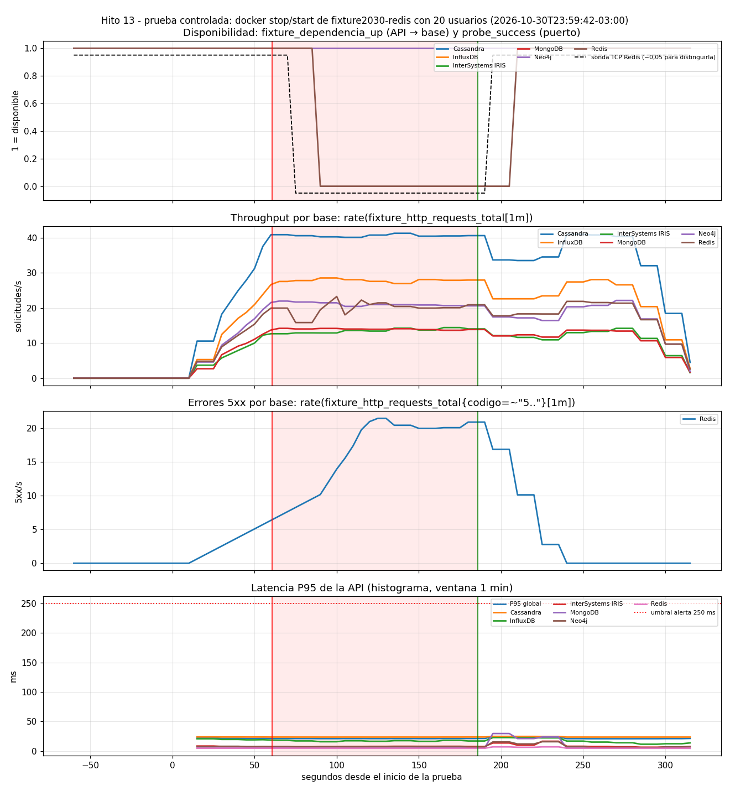

# Prueba de falla controlada (RF10) · Redis detenido con carga

## Procedimiento

`scripts/ejecutar_prueba_controlada.ps1` (valores por defecto), sobre contenedores y datos de laboratorio (RNF11):

1. **Integridad antes:** 15 claves por base comparadas con las huellas del catálogo del Hito 12.
2. **Carga constante:** 20 usuarios virtuales, mezcla del Hito 12 (Cassandra 30 %, InfluxDB 20 %, Redis 15 %, Neo4j 15 %, IRIS 10 %, MongoDB 10 %). Solo lecturas (GET).
3. **0-60 s:** tráfico normal.
4. **60 s:** `docker stop fixture2030-redis`. No se borra ningún volumen.
5. **~90 s:** `GET /health/dependencias?refrescar=true` para registrar la clasificación de la falla.
6. **180 s:** `docker start fixture2030-redis`. Se consulta la salud cada 5 s hasta que la API vuelve a usar Redis.
7. **270 s:** fin de la carga y 45 s de espera para el último scraping y la evaluación de las alertas.
8. **Integridad después.**
9. Se consultan a Prometheus 10 series de la ventana completa y se guardan junto con la línea de tiempo y un gráfico.

Si la prueba se interrumpe, el script vuelve a iniciar el contenedor.

## Resultado (corrida 3, configuración adoptada: corte rápido v2)

Carpeta [`prueba_de_falla_redis_corte10v2_20261030-235942/`](prueba_de_falla_redis_corte10v2_20261030-235942/README.md) · commit `c2363f2` · `IRIS_POOL_SIZE=5`, `CORTE_RAPIDO_SEGUNDOS=10`.

| Tramo | Duración | Solicitudes | req/s | 5xx | % 5xx | P95 cliente |
|---|---:|---:|---:|---:|---:|---:|
| Antes | 60,5 s | 8.189 | 135,3 | 0 | 0 % | 127 ms |
| Falla (Redis detenido) | 119,2 s | 16.415 | 137,7 | 2.492 | 15,2 % | 123 ms |
| Después | 79,6 s | 10.952 | 137,6 | 0 | 0 % | 125 ms |

Durante la falla, por base: MongoDB 1.665/1.665 OK, Neo4j 2.467/2.467, Cassandra 4.820/4.820, InfluxDB 3.310/3.310, IRIS 1.661/1.661, **Redis 0/2.492 (todas 503)**. **Las otras cinco bases no tuvieron ningún error.**

| Evento | Segundos desde el inicio |
|---|---:|
| `docker stop` | 60,5 |
| Prometheus registra el puerto cerrado (`probe_success = 0`) | 75 (+14,5 s) |
| Prometheus registra que la API no puede usar Redis (`fixture_dependencia_up = 0`) | 90 (+29,5 s) |
| `FixturePuertoDeBaseCerrado` y `FixtureBaseNoDisponibleParaLaApi` → *firing* | 150 |
| `FixtureErrores5xxAltos` → *firing* | 175 |
| `docker start` | 180,5 (tardó 5,2 s) |
| La API vuelve a usar Redis (`/health/dependencias`) | 191 (+10,5 s) |
| Prometheus registra la recuperación | 195 (sonda) / 210 (API) |
| Alertas de disponibilidad resueltas | 205 |

Integridad: **6/6 bases intactas antes y después** (`resultados_sin_secretos/integridad_datos_*.json`).

## Las tres corridas

| Corrida | Carpeta | Throughput durante la falla | Conclusión |
|---|---|---:|---|
| 1 · sin corte rápido | [`prueba_de_falla_redis_corte0_20261030-233034`](prueba_de_falla_redis_corte0_20261030-233034/README.md) | 47 req/s | Aislamiento sin errores, pero la caída de Redis frenó a toda la API |
| 2 · corte rápido v1 | [`prueba_de_falla_redis_corte10v1_20261030-235008`](prueba_de_falla_redis_corte10v1_20261030-235008/README.md) | 115 req/s | Mejora; quedaba un pico de 1,6 s en Redis al reintentar |
| 3 · corte rápido v2 | [`prueba_de_falla_redis_corte10v2_20261030-235942`](prueba_de_falla_redis_corte10v2_20261030-235942/README.md) | 138 req/s | Sin impacto en el throughput; P95 de Redis 4,9 ms |

Comparación completa: [`comparacion_corte_rapido.md`](comparacion_corte_rapido.md). Capturas del dashboard durante las corridas 2 y 3: [`dashboards/`](dashboards/).

