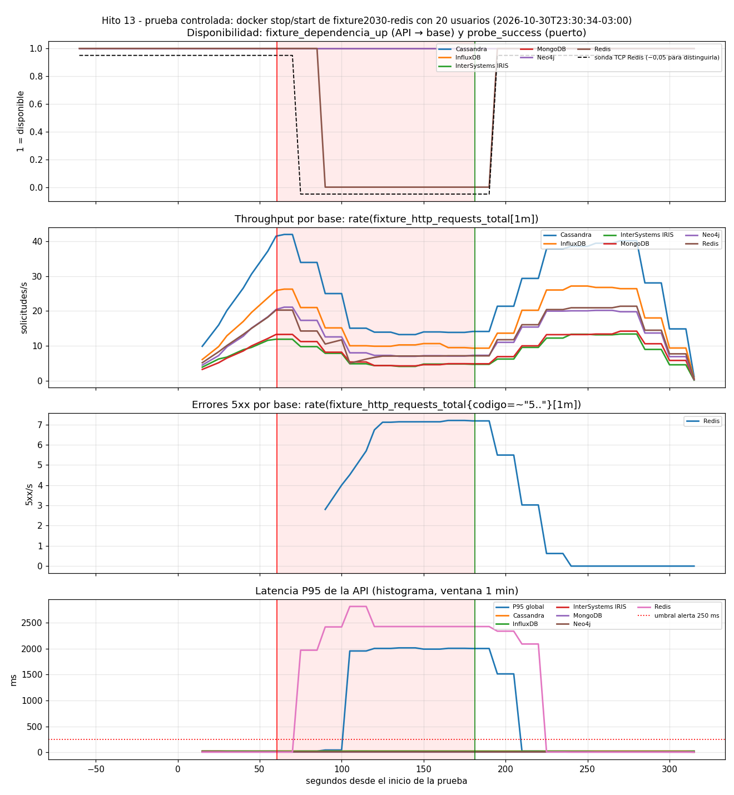

# Prueba controlada - redis (2026-10-30T23:30:34-03:00)

Generado por `scripts/ejecutar_prueba_controlada.py` · commit `27b8139 (con cambios sin commitear)`

Parámetros: 20 usuarios virtuales constantes, 60 s normales, 120 s con `fixture2030-redis` detenido, 90 s de recuperación.

## Lado cliente (medido por el generador)

| Tramo | Duración (s) | Solicitudes | req/s | 5xx | % 5xx | P50 ms | P95 ms |
|---|---:|---:|---:|---:|---:|---:|---:|
| antes | 60.6 | 8042 | 132.7 | 0 | 0.0 | 44.14 | 134.62 |
| falla | 119.1 | 5609 | 47.1 | 832 | 14.83 | 16.91 | 35.23 |
| despues | 84.0 | 11280 | 134.3 | 0 | 0.0 | 43.98 | 130.93 |

Durante la falla, por base:

| Base | Solicitudes | 2xx | 5xx | P95 ms (2xx) |
|---|---:|---:|---:|---:|
| MongoDB | 561 | 561 | 0 | 30.82 |
| Neo4j | 868 | 868 | 0 | 29.56 |
| Cassandra | 1651 | 1651 | 0 | 40.64 |
| Redis | 832 | 0 | 832 | None |
| InfluxDB | 1154 | 1154 | 0 | 35.55 |
| InterSystems IRIS | 543 | 543 | 0 | 30.55 |

**Aislamiento:** las demás bases siguieron respondiendo sin errores (832 errores 5xx en la base detenida, 0 en las demás).

## Línea de tiempo (segundos desde el inicio)

| Evento | s |
|---|---:|
| stop_inicio_s | 60.6 |
| stop_fin_s | 61.5 |
| start_inicio_s | 180.6 |
| start_fin_s | 181.2 |
| api_ve_recuperada_s | 186.5 |
| fin_carga_s | 270.5 |
| prometheus_registra_caida_api_s | 90.0 |
| prometheus_registra_puerto_cerrado_s | 75.0 |
| deteccion_desde_stop_api_s | 29.4 |
| deteccion_desde_stop_sonda_s | 14.4 |
| prometheus_registra_recuperacion_api_s | 195.0 |
| recuperacion_desde_start_api_s | 14.4 |
| recuperacion_desde_start_sonda_s | 14.4 |
| recuperacion_vista_por_la_api_s | 5.9 |

## Alertas registradas por Prometheus (serie ALERTS)

Una alerta pasa a *pending* cuando se cumple la condición y a *firing* cuando se mantiene durante su `for`.

| Alerta [estado] objeto | desde s | hasta s | ¿ya estaba antes? |
|---|---:|---:|---|
| FixtureBaseNoDisponibleParaLaApi [firing] Redis | 155.0 | 195.0 | no |
| FixtureBaseNoDisponibleParaLaApi [pending] Redis | 95.0 | 150.0 | no |
| FixtureErrores5xxAltos [firing] | 210.0 | 250.0 | no |
| FixtureErrores5xxAltos [pending] | 150.0 | 205.0 | no |
| FixtureLatenciaP95Alta [pending] | 180.0 | 220.0 | no |
| FixturePuertoDeBaseCerrado [firing] Redis | 140.0 | 195.0 | no |
| FixturePuertoDeBaseCerrado [pending] Redis | 80.0 | 135.0 | no |

