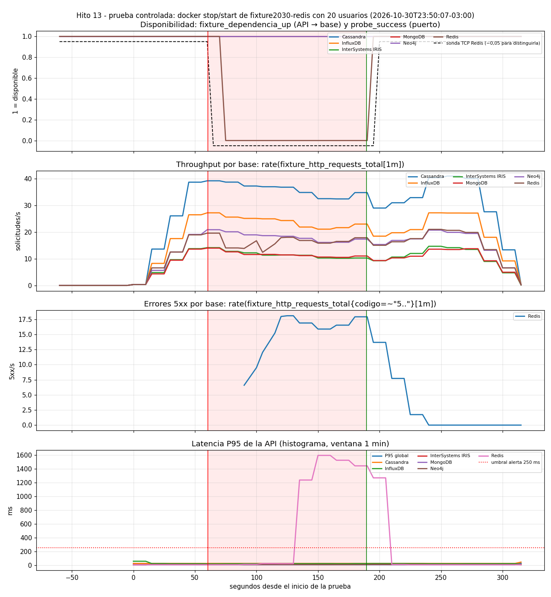

# Prueba controlada - redis (2026-10-30T23:50:07-03:00)

Generado por `scripts/ejecutar_prueba_controlada.py` · commit `2303e8c (con cambios sin commitear)`

Configuración de la API: `IRIS_POOL_SIZE=5`, `CORTE_RAPIDO_SEGUNDOS=10.0`.

Parámetros: 20 usuarios virtuales constantes, 60 s normales, 120 s con `fixture2030-redis` detenido, 90 s de recuperación.

## Lado cliente (medido por el generador)

| Tramo | Duración (s) | Solicitudes | req/s | 5xx | % 5xx | P50 ms | P95 ms |
|---|---:|---:|---:|---:|---:|---:|---:|
| antes | 60.6 | 8041 | 132.7 | 0 | 0.0 | 44.77 | 134.16 |
| falla | 119.0 | 13708 | 115.2 | 2095 | 15.28 | 43.14 | 133.8 |
| despues | 75.8 | 10282 | 135.6 | 0 | 0.0 | 42.9 | 131.23 |

Durante la falla, por base:

| Base | Solicitudes | 2xx | 5xx | P95 ms (2xx) |
|---|---:|---:|---:|---:|
| MongoDB | 1324 | 1324 | 0 | 130.22 |
| Neo4j | 2099 | 2099 | 0 | 130.81 |
| Cassandra | 4148 | 4148 | 0 | 135.68 |
| Redis | 2095 | 0 | 2095 | None |
| InfluxDB | 2746 | 2746 | 0 | 135.83 |
| InterSystems IRIS | 1296 | 1296 | 0 | 131.12 |

**Aislamiento:** las demás bases siguieron respondiendo sin errores (2095 errores 5xx en la base detenida, 0 en las demás).

## Línea de tiempo (segundos desde el inicio)

| Evento | s |
|---|---:|
| stop_inicio_s | 60.6 |
| stop_fin_s | 61.6 |
| start_inicio_s | 180.6 |
| start_fin_s | 189.4 |
| api_ve_recuperada_s | 194.8 |
| fin_carga_s | 270.6 |
| prometheus_registra_caida_api_s | 75.0 |
| prometheus_registra_puerto_cerrado_s | 65.0 |
| deteccion_desde_stop_api_s | 14.4 |
| deteccion_desde_stop_sonda_s | 4.4 |
| prometheus_registra_recuperacion_api_s | 195.0 |
| recuperacion_desde_start_api_s | 14.4 |
| recuperacion_desde_start_sonda_s | 19.4 |
| recuperacion_vista_por_la_api_s | 14.2 |

## Alertas registradas por Prometheus (serie ALERTS)

Una alerta pasa a *pending* cuando se cumple la condición y a *firing* cuando se mantiene durante su `for`.

| Alerta [estado] objeto | desde s | hasta s | ¿ya estaba antes? |
|---|---:|---:|---|
| FixtureBaseNoDisponibleParaLaApi [firing] Redis | 140.0 | 195.0 | no |
| FixtureBaseNoDisponibleParaLaApi [pending] Redis | 80.0 | 135.0 | no |
| FixtureErrores5xxAltos [firing] | 180.0 | 265.0 | no |
| FixtureErrores5xxAltos [pending] | 120.0 | 175.0 | no |
| FixturePuertoDeBaseCerrado [firing] Redis | 140.0 | 210.0 | no |
| FixturePuertoDeBaseCerrado [pending] Redis | 80.0 | 135.0 | no |

