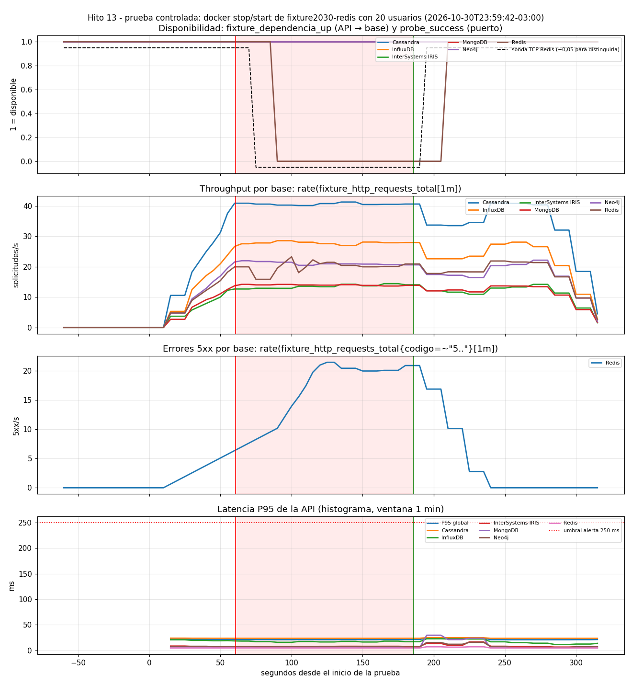

# Prueba controlada - redis (2026-10-30T23:59:42-03:00)

Generado por `scripts/ejecutar_prueba_controlada.py` · commit `c2363f2 (con cambios sin commitear)`

Configuración de la API: `IRIS_POOL_SIZE=5`, `CORTE_RAPIDO_SEGUNDOS=10.0`.

Parámetros: 20 usuarios virtuales constantes, 60 s normales, 120 s con `fixture2030-redis` detenido, 90 s de recuperación.

## Lado cliente (medido por el generador)

| Tramo | Duración (s) | Solicitudes | req/s | 5xx | % 5xx | P50 ms | P95 ms |
|---|---:|---:|---:|---:|---:|---:|---:|
| antes | 60.5 | 8189 | 135.3 | 0 | 0.0 | 43.04 | 126.73 |
| falla | 119.2 | 16415 | 137.7 | 2492 | 15.18 | 42.3 | 123.31 |
| despues | 79.6 | 10952 | 137.6 | 0 | 0.0 | 42.11 | 124.78 |

Durante la falla, por base:

| Base | Solicitudes | 2xx | 5xx | P95 ms (2xx) |
|---|---:|---:|---:|---:|
| MongoDB | 1665 | 1665 | 0 | 119.47 |
| Neo4j | 2467 | 2467 | 0 | 119.7 |
| Cassandra | 4820 | 4820 | 0 | 126.88 |
| Redis | 2492 | 0 | 2492 | None |
| InfluxDB | 3310 | 3310 | 0 | 124.31 |
| InterSystems IRIS | 1661 | 1661 | 0 | 123.37 |

**Aislamiento:** las demás bases siguieron respondiendo sin errores (2492 errores 5xx en la base detenida, 0 en las demás).

## Línea de tiempo (segundos desde el inicio)

| Evento | s |
|---|---:|
| stop_inicio_s | 60.5 |
| stop_fin_s | 61.3 |
| start_inicio_s | 180.5 |
| start_fin_s | 185.7 |
| api_ve_recuperada_s | 191.0 |
| fin_carga_s | 270.6 |
| prometheus_registra_caida_api_s | 90.0 |
| prometheus_registra_puerto_cerrado_s | 75.0 |
| deteccion_desde_stop_api_s | 29.5 |
| deteccion_desde_stop_sonda_s | 14.5 |
| prometheus_registra_recuperacion_api_s | 210.0 |
| recuperacion_desde_start_api_s | 29.5 |
| recuperacion_desde_start_sonda_s | 14.5 |
| recuperacion_vista_por_la_api_s | 10.5 |

## Alertas registradas por Prometheus (serie ALERTS)

Una alerta pasa a *pending* cuando se cumple la condición y a *firing* cuando se mantiene durante su `for`.

| Alerta [estado] objeto | desde s | hasta s | ¿ya estaba antes? |
|---|---:|---:|---|
| FixtureBaseNoDisponibleParaLaApi [firing] Redis | 150.0 | 205.0 | no |
| FixtureBaseNoDisponibleParaLaApi [pending] Redis | 90.0 | 145.0 | no |
| FixtureErrores5xxAltos [firing] | 175.0 | 275.0 | no |
| FixtureErrores5xxAltos [pending] | 115.0 | 170.0 | no |
| FixturePuertoDeBaseCerrado [firing] Redis | 150.0 | 205.0 | no |
| FixturePuertoDeBaseCerrado [pending] Redis | 90.0 | 145.0 | no |

