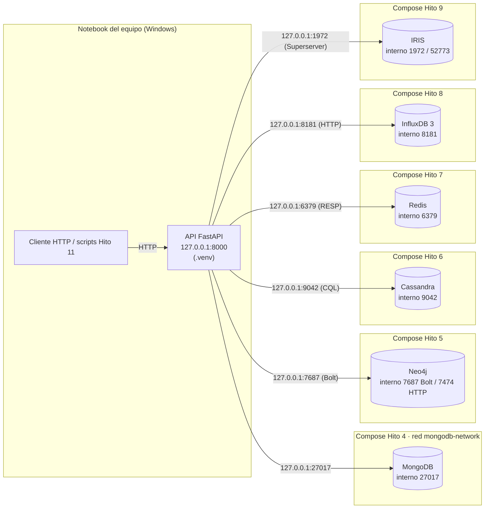

# Topología de conexión y entornos

## 1. Dónde corre cada proceso

| Proceso | Dónde se ejecuta | Cómo se inicia |
|---|---|---|
| API Fixture 2030 (FastAPI + uvicorn) | **Directamente en la notebook** (Windows), entorno virtual `.venv` con Python 3.10. **No** está en un contenedor | `scripts/reiniciar_api.ps1` → escucha en `127.0.0.1:8000` |
| Diagnóstico del Hito 11 | En la notebook, con el **mismo** `.venv` de la API | `hito11-conectividad/scripts/evaluar_conectividad.ps1` |
| MongoDB 7 (+ Mongo Express) | Contenedor Docker, proyecto Compose propio (Hito 4) | `docker compose up -d` en su carpeta |
| Neo4j | Contenedor Docker, proyecto Compose propio (Hito 5) | ídem |
| Cassandra 5.0 | Contenedor `fixture2030-cassandra`, proyecto Compose propio (Hito 6) | ídem |
| Redis | Contenedor `fixture2030-redis`, proyecto Compose propio (Hito 7) | ídem |
| InfluxDB 3 Core | Contenedor `fixture2030-influxdb`, proyecto Compose propio (Hito 8) | ídem |
| InterSystems IRIS Community | Contenedor `fixture2030-iris`, proyecto Compose propio (Hito 9) | ídem |

**Conclusión de topología:** la API y los productos **no** comparten una red Docker Compose. Cada hito tiene su propio `docker-compose.yml`, y Compose crea una red separada por proyecto (Hito 4 define `mongodb-network`; el resto usa la red `<proyecto>_default`). La API, que corre fuera de Docker, llega a cada producto a través de los **puertos publicados en la notebook**.

Por eso el diagnóstico se ejecuta desde la notebook: es el **origen real** de las conexiones de la API (RNF3).

### Variante: entorno local consolidado

Para ejecutar el Hito 11 en otra notebook se agregó [`entorno-local/`](../../entorno-local/README.md): un único proyecto Compose (`fixture2030`) con los seis servicios, los **mismos nombres de contenedor y puertos publicados**, y los scripts de carga originales de cada hito. En esa variante los contenedores comparten la red `fixture2030_default`, pero la API sigue corriendo en la notebook y sigue usando `127.0.0.1` + puerto publicado. La topología desde el punto de vista de la API no cambia. Lo que cambia es que, entre contenedores, cada servicio también sería alcanzable por su nombre de servicio (`mongodb:27017`, `neo4j:7687`, etc.).

## 2. Diagrama



## 3. Puertos internos y publicados

El **puerto interno** es aquel en el que escucha el proceso dentro del contenedor. El **puerto publicado** es el que Docker abre en la notebook y redirige al interno. La API solo puede usar el publicado.

| Producto | Puerto interno | Publicación en la notebook | Interfaz publicada | Fuente |
|---|---|---|---|---|
| MongoDB | 27017 | `27017:27017` | todas (`0.0.0.0`) | `docker-compose.yml` Hito 4 |
| Mongo Express | 8081 | `8081:8081` | todas | `docker-compose.yml` Hito 4 (no lo usa la API) |
| Neo4j Bolt | 7687 | `7687` | verificar con `docker ps` | Hito 5 (el compose no está en el repositorio) |
| Neo4j HTTP | 7474 | `7474` | verificar con `docker ps` | Hito 5 (no lo usa la API) |
| Cassandra | 9042 | `9042` | verificar con `docker ps` | Hito 6 (el compose no está en el repositorio) |
| Redis | 6379 | `6379:6379` | todas | `docker-compose.yml` Hito 7 |
| InfluxDB 3 | 8181 | `127.0.0.1:8181:8181` | **solo loopback** | `docker-compose.yml` Hito 8 |
| IRIS Superserver | 1972 | `127.0.0.1:1972:1972` | **solo loopback** | `docker-compose.yml` Hito 9 |
| IRIS Portal | 52773 | `127.0.0.1:52773:52773` | **solo loopback** | `docker-compose.yml` Hito 9 (no lo usa la API) |
| API | 8000 | — (no es contenedor) | `127.0.0.1` | `scripts/reiniciar_api.ps1` |

El modo `tcp` del diagnóstico ejecuta `docker inspect` y registra los puertos que publica cada contenedor. Así queda evidencia del mapeo real de Neo4j y Cassandra, cuyos compose no están en este repositorio.

**Consecuencias:**

- InfluxDB e IRIS publican solo en `127.0.0.1`: son alcanzables desde la notebook, pero **no** desde otra máquina de la red. Esto es correcto para el laboratorio.
- MongoDB y Redis publican en todas las interfaces: otra máquina de la misma red podría alcanzarlos. Se documenta como limitación de seguridad del laboratorio.

## 4. "localhost" no significa lo mismo en todos lados

| Origen de la conexión | `localhost` / `127.0.0.1` apunta a | Cómo llegar a MongoDB |
|---|---|---|
| Notebook (API, scripts del Hito 11) | la notebook | `127.0.0.1:27017` (puerto publicado) |
| Dentro del contenedor de MongoDB | el propio contenedor de MongoDB | `localhost:27017` (puerto interno; funciona solo porque es el mismo contenedor) |
| Dentro de **otro** contenedor (ej. Redis) | ese otro contenedor, donde no hay MongoDB → `connection refused` | `host.docker.internal:27017` (Docker Desktop → notebook → puerto publicado) |
| Un servicio en la **misma** red Compose | — | nombre del servicio + puerto interno (ej. `mongodb:27017`) |

Esto se puede demostrar con:

```powershell
.\hito11-conectividad\scripts\evaluar_conectividad.ps1 -Modo tcp -DesdeContenedor fixture2030-mongodb
```

La prueba abre `/dev/tcp/127.0.0.1/<puerto>` y `/dev/tcp/host.docker.internal/<puerto>` desde dentro del contenedor indicado. Desde un contenedor, `127.0.0.1` solo responde para su propio puerto. Por eso los CLI ejecutados con `docker exec` (modo `-Cli`) usan otro origen que la API, y su resultado se marca como complementario.

Además, el modo `config` emite una **ADVERTENCIA** si detecta que corre dentro de un contenedor con hosts `localhost`/`127.0.0.1` configurados.

## 5. Diferencias de entorno a considerar

| Diferencia | Efecto | Cómo se maneja |
|---|---|---|
| Otra notebook del grupo | Los nombres de contenedor o puertos pueden cambiar | Variables `*_CONTAINER` y puertos en `config/conectividad.env`; el contenedor se detecta por imagen si el nombre no coincide |
| API dentro de un contenedor (no es el caso actual) | `127.0.0.1` dejaría de apuntar a la notebook | Usar `host.docker.internal` o unir la API a las redes de los productos y usar nombres de servicio + puertos internos |
| Docker Desktop detenido | Todos los productos caen; `docker` CLI no responde | El modo `tcp` marca el estado del contenedor como SKIP (herramienta no disponible) y las capas TCP como `connection_refused` |
| Productos que no están iniciados | Esos productos fallan en la capa TCP | El diagnóstico es por producto (RNF13): `-Producto <nombre>` permite evaluar solo los iniciados |
